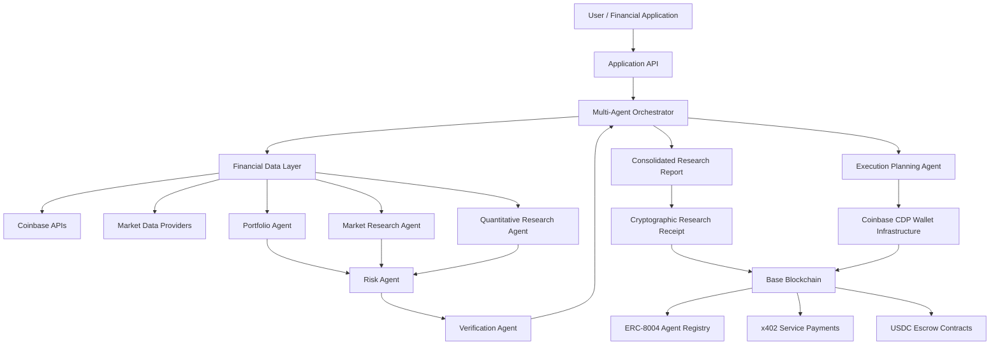
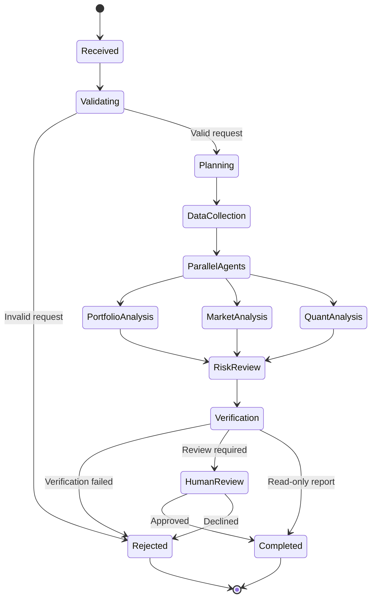
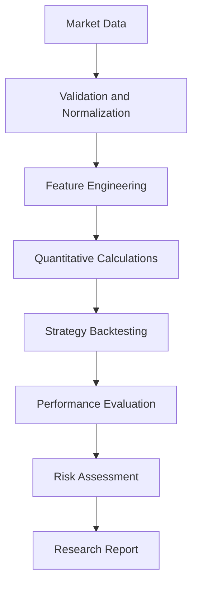
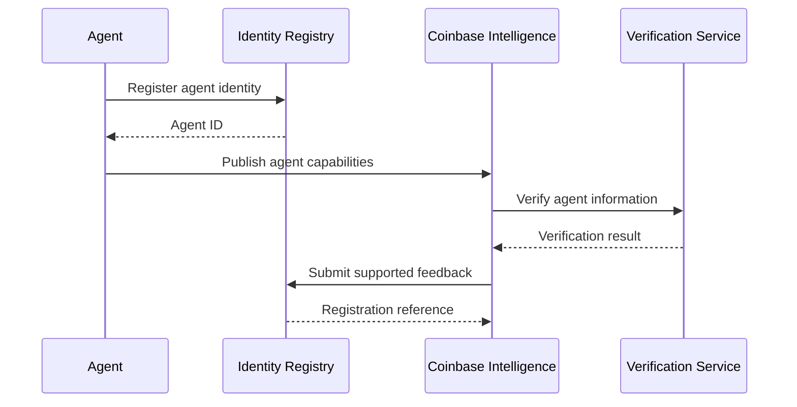
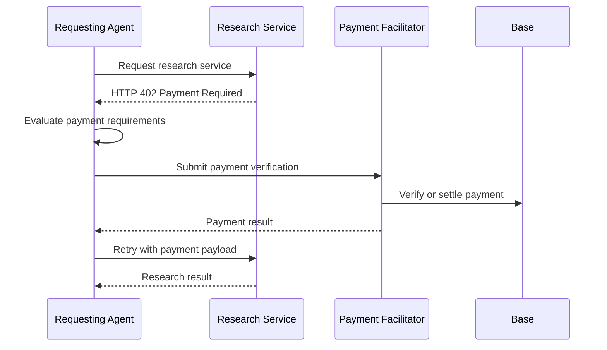
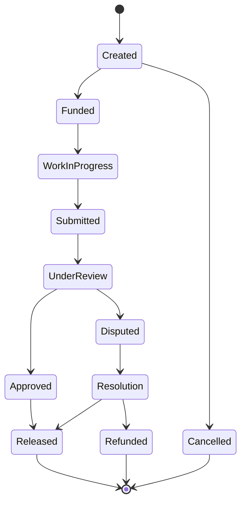
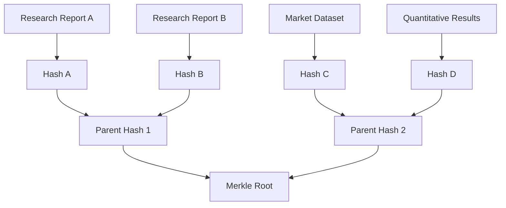
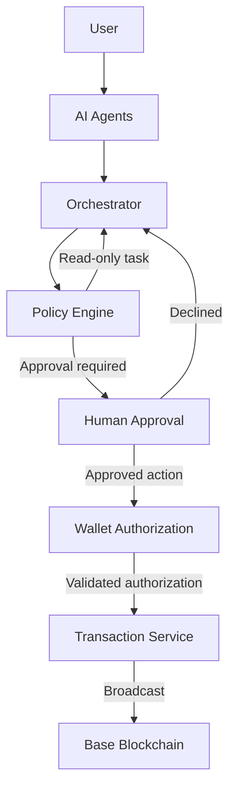
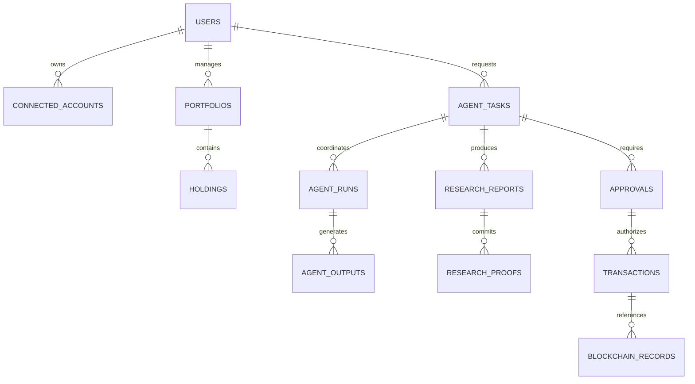
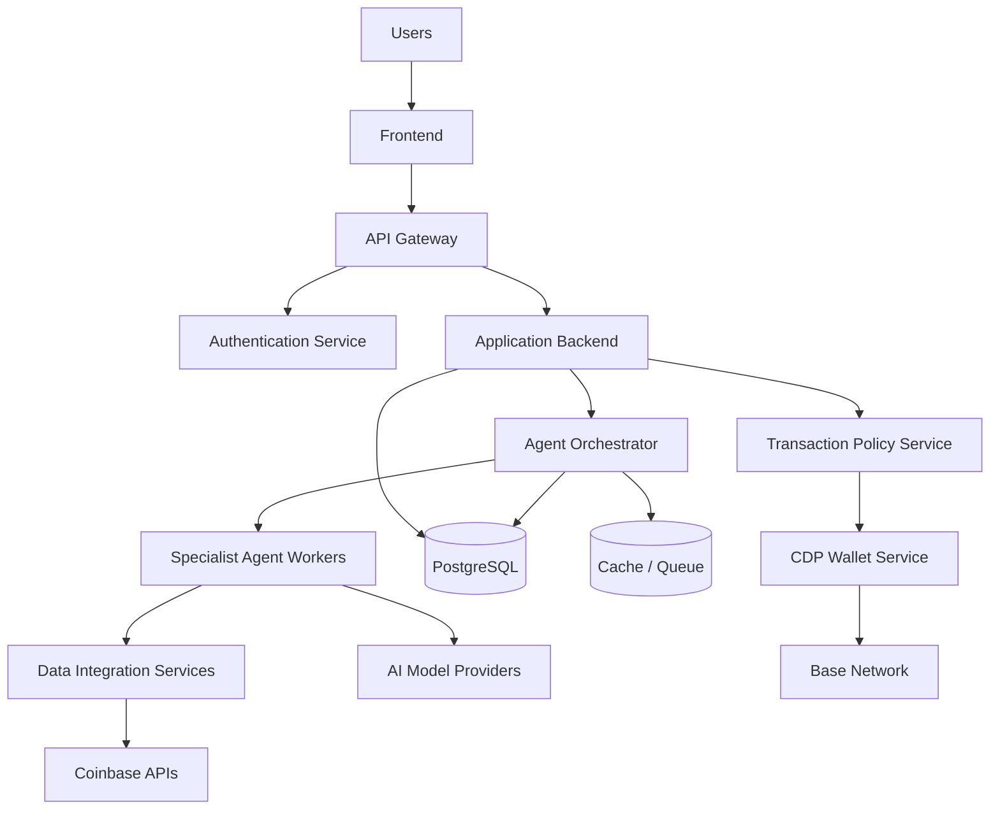

# Coinbase Intelligence
### Multi-Agent AI Financial Intelligence, Quantitative Research & Onchain Agent Economy

<p align="center">
  <strong>Intelligent Agents. Verifiable Research. Programmable Finance.</strong>
</p>

<p align="center">
  Connecting AI-powered financial intelligence with Coinbase infrastructure and the Base ecosystem.
</p>

.png?raw=true)
---

## Table of Contents

1. [Project Overview](#1-project-overview)
2. [The Problem](#2-the-problem)
3. [The Solution](#3-the-solution)
4. [Core Product Capabilities](#4-core-product-capabilities)
5. [Multi-Agent Architecture](#5-multi-agent-architecture)
6. [Agent Responsibilities and Intelligence](#6-agent-responsibilities-and-intelligence)
7. [Agent Orchestration Engine](#7-agent-orchestration-engine)
8. [Coinbase Infrastructure Integration](#8-coinbase-infrastructure-integration)
9. [Quantitative Research Engine](#9-quantitative-research-engine)
10. [Portfolio Intelligence and Risk Management](#10-portfolio-intelligence-and-risk-management)
11. [Base Blockchain Architecture](#11-base-blockchain-architecture)
12. [ERC-8004 Agent Identity and Reputation](#12-erc-8004-agent-identity-and-reputation)
13. [x402 Agent-to-Agent Payments](#13-x402-agent-to-agent-payments)
14. [USDC Escrow and Settlement](#14-usdc-escrow-and-settlement)
15. [Verifiable Research and Merkle Proofs](#15-verifiable-research-and-merkle-proofs)
16. [Security and Governance](#16-security-and-governance)
17. [Data Architecture](#17-data-architecture)
18. [API Architecture](#18-api-architecture)
19. [Developer Setup](#19-developer-setup)
20. [Environment Configuration](#20-environment-configuration)
21. [Testing and Quality Assurance](#21-testing-and-quality-assurance)
22. [Deployment Architecture](#22-deployment-architecture)
23. [Observability and Agent Monitoring](#23-observability-and-agent-monitoring)
24. [Implementation Roadmap](#24-implementation-roadmap)
25. [Future Possibilities](#25-future-possibilities)
26. [Responsible Use and Limitations](#26-responsible-use-and-limitations)
27. [Contributing](#27-contributing)
28. [License](#28-license)
29. [References](#29-references)

---

# 1. Project Overview

## Coinbase Intelligence

Coinbase Intelligence is a multi-agent artificial intelligence platform designed to connect financial data, quantitative research, portfolio intelligence, blockchain infrastructure, and autonomous agent collaboration.

The project explores a new financial infrastructure model where specialized AI agents work together to interpret financial information, independently evaluate research, assess portfolio risks, and coordinate programmable financial services.

Rather than relying on one general-purpose AI model to answer every financial question, Coinbase Intelligence introduces a modular network of specialized agents.

Each agent operates within a defined responsibility, receives structured information, produces an independently identifiable result, and contributes to a coordinated intelligence workflow.

The platform brings together five major technological domains:

| Domain | Purpose |
|---|---|
| Financial Intelligence | Coinbase account information, asset allocation, and portfolio analytics |
| Multi-Agent AI | Specialized AI agents that collaborate on complex financial tasks |
| Quantitative Research | Market analysis, technical indicators, historical research, and strategy evaluation |
| Blockchain Infrastructure | Base smart contracts, programmable wallets, and onchain records |
| Agent Economy | Agent identity, reputation, service payments, and verifiable research |

The central objective is to develop an ecosystem in which AI agents can perform useful financial intelligence tasks while maintaining transparency, accountability, authorization boundaries, and human oversight.

### Core philosophy

**AI should coordinate intelligence, not control financial ownership.**

Coinbase Intelligence separates analysis, recommendations, authorization, and transaction execution.

AI agents may identify opportunities, evaluate strategies, and prepare transaction proposals. They should not independently gain unrestricted authority over a user's financial assets.

Financial actions must be governed by explicit permissions, transaction policies, and applicable human approvals.

### Project goals

- Develop a coordinated multi-agent financial intelligence system.
- Connect authorized Coinbase financial information to specialized AI agents.
- Build quantitative market research and portfolio risk analysis capabilities.
- Explore programmable wallet infrastructure through Coinbase CDP.
- Establish an onchain agent identity and reputation layer.
- Enable machine-to-machine services through x402.
- Explore milestone-based USDC settlement through smart contracts.
- Generate tamper-evident research records using cryptographic commitments.
- Establish an architecture that can support additional agents and external services.

---

# 2. The Problem

Financial intelligence is fragmented across exchanges, portfolio applications, blockchain explorers, research platforms, and specialized analytical tools.

Users often need to manually connect information from multiple systems before they can make sense of their financial position.

At the same time, the development of AI agents introduces a new challenge: different agents may produce recommendations without a consistent mechanism for validating their work, establishing their reputation, or coordinating their actions.

Coinbase Intelligence addresses several infrastructure problems.

## 2.1 Fragmented financial information

Portfolio data, asset prices, account balances, historical market information, and blockchain activity often exist in separate systems.

A financial intelligence workflow needs a consistent data layer that can normalize information from authorized sources.

## 2.2 General-purpose AI limitations

A single AI assistant may be responsible for market research, technical analysis, portfolio allocation, risk management, and execution planning.

These tasks require different expertise, data, and evaluation criteria.

Specialized agents provide a modular alternative.

## 2.3 Limited agent accountability

An AI-generated financial report does not automatically establish:

- Which agent produced the report.
- What data was used.
- What methodology was applied.
- Which assumptions were made.
- Whether another agent independently verified the findings.
- Whether the report has changed since publication.

Coinbase Intelligence explores identity registries, reputation signals, validation services, and cryptographic research records to address these questions.

## 2.4 Missing economic infrastructure between agents

Agents may depend on external market data, research providers, analytics services, and other specialist agents.

Traditional service-payment mechanisms are not designed around every machine-to-machine interaction.

The x402 protocol introduces an HTTP-native payment mechanism that can support paid programmatic services.

## 2.5 Financial authorization and trust

Autonomous systems should not be granted unrestricted financial authority simply because they can generate convincing recommendations.

A financial intelligence platform needs enforceable permission boundaries, limited wallet authority, transaction simulation, risk checks, and human approval.

---

# 3. The Solution

Coinbase Intelligence introduces a coordinated architecture that combines specialist AI agents with financial APIs and blockchain-based infrastructure.

Instead of allowing agents to act independently without supervision, the platform establishes a structured workflow.

### Intelligence workflow

1. A user submits a financial research or portfolio question.
2. The orchestration engine determines which specialist agents are required.
3. Relevant authorized financial and market data is retrieved.
4. Specialist agents independently evaluate their assigned tasks.
5. The risk agent reviews important findings and potential financial exposure.
6. A verification agent checks the evidence, calculations, and assumptions.
7. The orchestrator combines the results into a consolidated research report.
8. A cryptographic commitment can be generated for the completed report.
9. An optional authorized blockchain workflow can publish an associated record.
10. Any financial transaction requires a separate authorization process.

### High-level system design



The architecture is modular. Financial data access, AI orchestration, quantitative calculations, and blockchain transactions are separate concerns.

This separation allows the platform to evolve without requiring every component to be rebuilt when one technology changes.

---

# 4. Core Product Capabilities

Coinbase Intelligence is organized around seven capability domains.

## 4.1 Portfolio Intelligence

Provides an analytical layer over authorized financial account information.

Potential functionality:

- Portfolio balance aggregation.
- Asset allocation analysis.
- Portfolio concentration measurements.
- Historical performance calculations.
- Holdings categorization.
- Exposure analysis.
- Portfolio change detection.
- Risk summaries.
- Research recommendations.

The portfolio intelligence system should distinguish between account-reported balances, independently calculated valuations, and estimated market values.

## 4.2 Market Intelligence

Evaluates market information from configured data providers.

Potential functionality:

- Asset price monitoring.
- Historical price analysis.
- Price trend identification.
- Volatility measurements.
- Technical indicators.
- Market regime analysis.
- Cross-asset comparisons.
- Market research summaries.

All market information should include its source, timestamp, currency, and retrieval status.

## 4.3 Quantitative Research

A specialist research layer for systematic market analysis.

Potential functionality:

- Strategy hypothesis generation.
- Historical backtesting.
- Performance measurement.
- Risk-adjusted return analysis.
- Volatility modeling.
- Drawdown analysis.
- Parameter sensitivity testing.
- Strategy comparison.

AI-generated hypotheses should never replace deterministic numerical calculations.

## 4.4 Multi-Agent Collaboration

The coordination infrastructure assigns different aspects of a task to independent specialists.

This makes it possible to compare different analytical perspectives before generating a final conclusion.

## 4.5 Risk and Verification

A dedicated layer evaluates:

- Data completeness.
- Calculation consistency.
- Portfolio concentration.
- Potential downside exposure.
- Transaction limits.
- Policy violations.
- Unsupported analytical claims.
- Research reproducibility.

## 4.6 Onchain Agent Infrastructure

Base provides the programmable blockchain layer for selected platform records and services.

Potential functionality:

- Agent registration.
- Agent identity.
- Reputation signals.
- Research commitments.
- Payment settlement.
- Escrow workflows.
- Transaction receipts.

## 4.7 Verifiable Research

Completed research can produce a cryptographic receipt that references the report's contents and its provenance.

This provides a mechanism to detect subsequent changes to the committed information.

A proof of data integrity is not automatically proof that the underlying financial analysis is correct.

---

# 5. Multi-Agent Architecture

The platform uses a specialist-agent architecture.

Each agent receives a bounded task, accesses only the tools permitted for that task, and returns structured output.

The orchestrator maintains workflow state and determines when to proceed, request additional evidence, or stop execution.

## 5.1 Agent architecture principles

Each specialist agent should implement:

1. A clearly defined role.
2. A constrained set of tools.
3. Explicit input requirements.
4. A structured output contract.
5. Error handling.
6. Evidence references.
7. Execution limits.
8. An identifiable execution record.

Agents should not silently modify another agent's conclusions.

If an agent disagrees with another agent, the disagreement should be preserved as structured evidence.

## 5.2 Agent registry

| Agent | Responsibility | Output |
|---|---|---|
| Portfolio Agent | Analyze portfolio data | Portfolio assessment |
| Market Agent | Evaluate market conditions | Market intelligence |
| Quant Agent | Perform numerical research | Quantitative report |
| Risk Agent | Identify financial and operational risks | Risk assessment |
| Verification Agent | Check research quality | Verification result |
| Execution Planner | Prepare authorized-action proposals | Transaction proposal |
| Orchestrator | Coordinate the workflow | Final consolidated result |

## 5.3 Shared agent context

Agents should receive a restricted context object rather than unrestricted access to the entire user session.

Example logical structure:

```json
{
  "task_id": "task_001",
  "user_id": "user_reference",
  "objective": "Analyze portfolio concentration",
  "network": "base",
  "created_at": "2026-11-06T12:00:00Z",
  "permissions": {
    "account_read": true,
    "market_data_read": true,
    "transaction_signing": false,
    "transaction_execution": false
  },
  "required_agents": [
    "portfolio",
    "market",
    "risk",
    "verification"
  ],
  "status": "pending"
}
```

This is an illustrative interface rather than an assertion about the project's existing database schema.

## 5.4 Agent output contract

A standardized response format helps the orchestrator validate different specialist results.

```json
{
  "agent_id": "portfolio-agent",
  "task_id": "task_001",
  "status": "completed",
  "summary": "Portfolio concentration assessment completed.",
  "findings": [
    {
      "category": "concentration",
      "observation": "One asset represents a significant portfolio allocation.",
      "severity": "medium"
    }
  ],
  "evidence": [],
  "assumptions": [],
  "limitations": [],
  "confidence": 0.91,
  "requires_review": true
}
```

Confidence values are model-generated estimates, not statistically calibrated probabilities unless a separate calibration process establishes that interpretation.

---

# 6. Agent Responsibilities and Intelligence

## 6.1 Portfolio Agent

The Portfolio Agent evaluates account information retrieved from authorized Coinbase integrations.

Responsibilities:

- Normalize asset holdings.
- Calculate portfolio allocation.
- Identify concentration.
- Compare account balances with market valuations.
- Identify missing price information.
- Calculate portfolio composition.
- Prepare portfolio summaries.

Example:

```text
TASK:
Analyze the concentration of the current portfolio.

INPUT:
Authorized account holdings.
Asset identifiers.
Market price observations.
Valuation timestamps.

OUTPUT:
Asset allocation.
Largest holdings.
Concentration observations.
Missing data.
Research recommendations.
```

The agent should not assume that an unavailable account balance is zero.

## 6.2 Market Research Agent

The Market Research Agent analyzes market information.

Responsibilities:

- Retrieve authorized market observations.
- Summarize price movements.
- Compare multiple assets.
- Evaluate volatility.
- Identify significant market changes.
- Report source and timestamp information.

Example analysis:

```text
Market Research Request

Asset: BTC

Evaluate:
1. Recent price movement.
2. Historical volatility.
3. Volume changes.
4. Relevant technical indicators.
5. Potential market risks.

Return:
A structured research summary with evidence.
```

## 6.3 Quantitative Research Agent

The Quant Agent handles mathematically reproducible research.

Possible calculations include:

**Simple return**

\[
R_t = \frac{P_t-P_{t-1}}{P_{t-1}}
\]

**Log return**

\[
r_t = \ln\left(\frac{P_t}{P_{t-1}}\right)
\]

**Historical volatility**

\[
\sigma = \sqrt{N}\cdot SD(r_t)
\]

Where:

- \(P_t\) is the current price.
- \(P_{t-1}\) is the previous observation.
- \(N\) is the appropriate annualization factor.
- \(SD\) represents standard deviation.

Additional calculations:

- Sharpe ratio.
- Maximum drawdown.
- Moving averages.
- Relative strength index.
- Beta estimates.
- Correlation matrices.
- Rolling volatility.
- Strategy returns.

Every calculation should specify its observation window, frequency, data source, and assumptions.

## 6.4 Risk Agent

The Risk Agent independently evaluates potential downside scenarios and policy violations.

Responsibilities:

- Identify portfolio concentration.
- Evaluate volatility exposure.
- Analyze drawdown scenarios.
- Flag incomplete financial information.
- Evaluate proposed transaction size.
- Check configured spending limits.
- Identify excessive agent permissions.

The Risk Agent should be capable of rejecting an otherwise valid workflow.

## 6.5 Verification Agent

The Verification Agent acts as an independent reviewer.

Its responsibilities:

- Check whether claims are supported by evidence.
- Validate data source references.
- Recalculate selected metrics.
- Detect contradictory findings.
- Identify unsupported assumptions.
- Verify that required agents completed their tasks.
- Flag missing or inconsistent information.

A verification result should distinguish:

- Verified.
- Partially verified.
- Not verified.
- Rejected.
- Requires human review.

The agent should never report a successful verification simply because all other agents completed execution.

## 6.6 Execution Planning Agent

This agent transforms approved analytical findings into a structured proposed action.

It can prepare:

- Proposed asset.
- Proposed transaction type.
- Proposed quantity.
- Estimated transaction value.
- Estimated fees.
- Expected network.
- Applicable policy checks.
- Approval requirements.

It should not possess unrestricted trading authority.

Transaction signing and broadcasting belong to a separately secured execution service governed by explicit user authorization.

---

# 7. Agent Orchestration Engine

The orchestration engine coordinates specialist agents.

It is responsible for task decomposition, workflow state, retries, dependency management, result validation, and final report generation.

LangGraph is a potential implementation framework for stateful workflows, conditional transitions, and human-in-the-loop controls.

## 7.1 Orchestration lifecycle



## 7.2 Parallel agent execution

Tasks that do not depend on each other's outputs may execute concurrently.

For example:

```typescript
interface ResearchTask {
  taskId: string;
  objective: string;
  portfolioContext?: Record<string, unknown>;
  marketContext?: Record<string, unknown>;
}

interface AgentResult {
  agentId: string;
  status: "completed" | "failed";
  findings: Record<string, unknown>;
  evidence: string[];
}

async function executeResearch(
  task: ResearchTask
): Promise<AgentResult[]> {
  const results = await Promise.allSettled([
    portfolioAgent(task),
    marketAgent(task),
    quantitativeAgent(task)
  ]);

  return results.map((result, index) => {
    if (result.status === "fulfilled") {
      return result.value;
    }

    return {
      agentId: `agent-${index}`,
      status: "failed",
      findings: {
        error: "Agent execution failed"
      },
      evidence: []
    };
  });
}
```

This example illustrates orchestration behavior and requires actual agent implementations.

## 7.3 Failure management

The orchestrator should handle:

- Agent timeouts.
- API rate limits.
- Invalid responses.
- Missing financial data.
- Model provider outages.
- Duplicate task submissions.
- Incomplete research.
- Conflicting conclusions.

Retry policies should be bounded.

Financial actions must never be automatically repeated just because an API request timed out.

Before any retry involving an external transaction, the transaction service must establish whether the original request was already accepted.

## 7.4 Human-in-the-loop controls

The platform should support checkpoints before:

- Publishing sensitive research records.
- Submitting paid agent requests.
- Approving escrow releases.
- Signing transactions.
- Broadcasting financial operations.

Approval should be attached to the exact action payload, including its destination, network, amount, and policy version.

---

# 8. Coinbase Infrastructure Integration

Coinbase infrastructure provides the financial and programmable wallet interfaces around which the platform can be developed.

Relevant components include:

- Coinbase Developer Platform.
- CDP Wallet APIs.
- Coinbase Advanced Trade APIs.
- Coinbase market information.
- Coinbase developer tooling.
- Coinbase MCP-related capabilities.

Official documentation:

- [Coinbase Developer Platform](https://docs.cdp.coinbase.com/)
- [Coinbase Advanced Trade API](https://docs.cdp.coinbase.com/coinbase-app/advanced-trade-apis/welcome)
- [CDP Wallet API](https://docs.cdp.coinbase.com/wallet-api/v2/introduction/welcome)
- [Coinbase Developer Resources](https://www.coinbase.com/developer-platform)

## 8.1 Coinbase account data

The account data service should retrieve only the financial information authorized for the connected user.

Potential data:

- Account identifiers.
- Supported asset balances.
- Available balances.
- Account currency.
- Asset information.
- Transaction history where authorized.
- Portfolio information.

Financial records should be normalized before being passed to AI agents.

Example:

```json
{
  "source": "coinbase",
  "account_reference": "account_001",
  "asset": "ETH",
  "quantity": "2.50000000",
  "currency": "USD",
  "valuation": "0.00",
  "valuation_status": "awaiting_market_data",
  "retrieved_at": "2026-11-06T12:00:00Z"
}
```

Use decimal-safe arithmetic for monetary calculations. Avoid binary floating-point operations for transaction amounts.

## 8.2 Advanced Trade integration

The Advanced Trade API can provide an integration point for supported account, market data, and trading workflows.

Potential integration responsibilities:

- Retrieve product information.
- Retrieve candles and market observations.
- Read authorized account information.
- Prepare order proposals.
- Submit orders only through an explicitly authorized execution workflow.

Account permissions should follow the principle of least privilege.

A market research agent should not require trading permissions simply to retrieve price information.

## 8.3 Coinbase Wallet Infrastructure

The CDP Wallet API can provide programmable wallet capabilities.

Potential use cases:

- Create or manage application wallets.
- Submit authorized EVM transactions.
- Interact with Base smart contracts.
- Support programmable accounts.
- Establish transaction policies.

Official quickstart:

[Coinbase CDP Wallet API Quickstart](https://docs.cdp.coinbase.com/wallet-api/v2/introduction/quickstart)

Wallet infrastructure should remain independent of the language model layer.

AI agents should never receive private keys, wallet secrets, or unrestricted signing credentials.

## 8.4 MCP integration

Model Context Protocol can expose selected financial tools to AI agents through structured interfaces.

Potential tool categories:

```text
coinbase_get_accounts
coinbase_get_balances
coinbase_get_product
coinbase_get_market_data
coinbase_get_order_book
coinbase_get_candles
portfolio_get_allocation
portfolio_calculate_risk
research_create_report
research_verify_report
```

Each tool must enforce user authorization independently.

MCP tool availability does not automatically authorize a financial transaction.

---

# 9. Quantitative Research Engine

The Quantitative Research Engine is designed to provide a reproducible computational layer.

It should separate model-generated reasoning from deterministic financial calculations.

## 9.1 Data ingestion

The research pipeline accepts time-series market observations.

A normalized observation can contain:

```json
{
  "asset": "BTC",
  "timestamp": "2026-11-06T12:00:00Z",
  "open": "100000.00",
  "high": "101000.00",
  "low": "99000.00",
  "close": "100500.00",
  "volume": "1234.50",
  "source": "configured_market_provider",
  "interval": "1h"
}
```

Values are examples, not live market quotations.

## 9.2 Analytical modules

| Module | Purpose |
|---|---|
| Return Engine | Calculate periodic and cumulative returns |
| Volatility Engine | Measure historical price variability |
| Trend Engine | Evaluate moving averages and market direction |
| Drawdown Engine | Measure historical losses from peaks |
| Correlation Engine | Evaluate relationships between assets |
| Strategy Engine | Evaluate defined research hypotheses |
| Backtest Engine | Simulate historical trading rules |
| Validation Engine | Check research assumptions and methodology |

## 9.3 Strategy evaluation

A backtesting engine should include:

- Training and evaluation windows.
- Transaction cost assumptions.
- Slippage assumptions.
- Position sizing.
- Execution constraints.
- Data quality checks.
- Survivorship bias controls.
- Look-ahead bias controls.
- Out-of-sample evaluation.

Historical profitability is not evidence of future profitability.

## 9.4 Example research workflow



## 9.5 Research result structure

Each quantitative result should contain:

```json
{
  "research_id": "research_001",
  "asset": "BTC",
  "methodology": "historical_volatility",
  "observation_window": "365_days",
  "sampling_frequency": "1_day",
  "annualization_factor": 365,
  "result": null,
  "data_source": "configured_market_provider",
  "limitations": [],
  "created_at": "2026-11-06T12:00:00Z"
}
```

A calculation should not be considered complete unless its inputs and methodology can be identified.

---

# 10. Portfolio Intelligence and Risk Management

Portfolio intelligence translates financial account information into a structured view of financial exposure.

## 10.1 Portfolio metrics

Potential metrics include:

- Total portfolio value.
- Asset allocation.
- Percentage allocation.
- Largest holding.
- Concentration.
- Historical returns.
- Volatility.
- Maximum drawdown.
- Asset correlation.
- Liquidity observations.

## 10.2 Allocation calculation

For asset \(i\):

\[
w_i = \frac{V_i}{\sum_{j=1}^{n} V_j}
\]

Where:

- \(V_i\) is the valuation of asset \(i\).
- \(w_i\) is its portfolio weight.
- \(n\) represents the number of included assets.

The calculation should only include assets with valid valuation data.

## 10.3 Concentration measurement

A possible measurement is the Herfindahl-Hirschman Index:

\[
HHI = \sum_{i=1}^{n}w_i^2
\]

This can provide a numerical representation of allocation concentration.

The index must be interpreted alongside portfolio composition and asset correlation.

## 10.4 Transaction risk checks

Before any proposed financial action:

1. Confirm user authorization.
2. Confirm the destination and asset.
3. Check the transaction amount.
4. Evaluate spending limits.
5. Estimate transaction fees.
6. Validate network compatibility.
7. Simulate the transaction where supported.
8. Require any necessary human approval.
9. Submit only the approved transaction.
10. Record the result.

## 10.5 Risk policy configuration

Example:

```json
{
  "policy_version": "1.0",
  "execution_mode": "approval_required",
  "max_transaction_value": "100.00",
  "require_simulation": true,
  "require_destination_validation": true,
  "require_human_approval": true,
  "allow_unrestricted_agent_signing": false
}
```

Limits should be enforced by the transaction service and wallet infrastructure, not merely described in an AI prompt.

---

# 11. Base Blockchain Architecture

Base provides an Ethereum-compatible blockchain environment for the onchain components of Coinbase Intelligence.

Official resources:

- [Base Documentation](https://docs.base.org/)
- [Base Developer Portal](https://www.base.org/builders)
- [Base Chain Reference](https://docs.base.org/base-chain/api-reference/ethereum-json-rpc-api/eth_chainId)

## 11.1 Network configuration

| Network | Chain ID | Intended use |
|---|---:|---|
| Base Mainnet | 8453 | Production network |
| Base Sepolia | 84532 | Testing and development |

The application should validate chain IDs before submitting any transaction.

## 11.2 Onchain architecture

Potential smart contract modules:

```text
CoinbaseIntelligence
│
├── AgentIdentity
│   └── Agent registration references
│
├── AgentReputation
│   └── Reputation and feedback
│
├── ResearchRegistry
│   └── Research commitments
│
├── ResearchVerification
│   └── Verification references
│
├── AgentPayment
│   └── Service payment records
│
└── USDCEscrow
    ├── Milestone creation
    ├── Funding
    ├── Approval
    ├── Settlement
    └── Refund
```

The modules are proposed logical boundaries. They do not imply that every contract currently exists in the repository.

## 11.3 Why Base?

Base provides an EVM-compatible environment and access to familiar Ethereum development tooling.

Benefits for this architecture include:

- Solidity smart contracts.
- EVM wallet compatibility.
- ERC token standards.
- Onchain transaction records.
- Programmable account infrastructure.
- Integration with Viem and Foundry.
- Access to USDC payment infrastructure.

## 11.4 Smart contract design principles

Contracts should be designed around explicit roles and limited responsibilities.

Important considerations:

- Access control.
- Reentrancy protection.
- Integer precision.
- Safe token transfers.
- Transaction expiration.
- Replay protection.
- Event emission.
- Emergency pause mechanisms where appropriate.
- Upgrade governance.
- Independent security review.

## 11.5 Transaction simulation

Before executing a smart contract write, use a supported simulation mechanism.

Viem provides `simulateContract` for validating a contract interaction before broadcasting a transaction.

Documentation:

- [Viem Public Client](https://viem.sh/docs/clients/public)
- [Viem simulateContract](https://viem.sh/docs/contract/simulateContract)
- [Viem writeContract](https://viem.sh/docs/contract/writeContract)

---

# 12. ERC-8004 Agent Identity and Reputation

ERC-8004 introduces an onchain framework for discovering agents and establishing trust through identity, reputation, and validation mechanisms.

Reference:

[ERC-8004: Trustless Agents](https://eips.ethereum.org/EIPS/eip-8004)

Coinbase Intelligence explores ERC-8004 as a foundation for an agent identity and reputation layer.

## 12.1 Why agent identity matters

When an external agent provides financial research or an analytical service, the receiving system needs a way to identify that agent.

A persistent identity can help connect:

- Agent metadata.
- Advertised capabilities.
- Agent registration information.
- Reputation signals.
- Validation records.
- Service endpoints.

## 12.2 Proposed identity workflow



## 12.3 Identity registry

Each participating agent can have:

- An agent identifier.
- A registered owner.
- A metadata URI.
- A declared capability list.
- Relevant service endpoints.
- A supported verification policy.

Identity is not equivalent to trustworthiness.

An agent may have a valid registered identity while still providing inaccurate or malicious information.

## 12.4 Reputation system

The reputation layer can collect structured feedback.

Potential signals:

| Signal | Description |
|---|---|
| Completion | Whether the agent completed the task |
| Accuracy | Whether findings passed independent verification |
| Reliability | Whether the agent responded consistently |
| Latency | Time required to complete a task |
| Availability | Whether the service was reachable |
| Policy Compliance | Whether the agent respected task restrictions |

Reputation should be based on attributable evidence rather than arbitrary model-generated ratings.

## 12.5 Independent validation

For higher-value research, the platform can request independent validation.

Potential validation methods include:

- Independent numerical recalculation.
- Independent data-source verification.
- Reproducible execution.
- Validator services.
- Cryptographic commitments.
- Trusted execution or other suitable verification mechanisms.

ERC-8004 supports the broader concept of an agent trust ecosystem, but registration alone does not guarantee that an agent is safe or accurate.

---

# 13. x402 Agent-to-Agent Payments

x402 is an open payment protocol built around HTTP-native payment requirements.

Official documentation:

- [x402](https://www.x402.org/)
- [x402 Foundation](https://github.com/x402-foundation/x402)
- [Coinbase CDP Documentation](https://docs.cdp.coinbase.com/)

## 13.1 The problem with traditional service payments

Suppose a market intelligence agent requires an external research service.

Traditional workflows may require an account, subscription, API key, and separate billing arrangement.

An agent-native payment mechanism allows a client to discover a paid endpoint, satisfy its payment requirements, and retry the request.

## 13.2 x402 workflow



The precise signing, verification, and settlement behavior depends on the selected x402 scheme and implementation.

## 13.3 Potential agent services

Coinbase Intelligence could support payments for:

- Market research.
- Data enrichment.
- Portfolio analysis.
- Strategy evaluation.
- Independent verification.
- Risk reports.
- Specialized research services.

## 13.4 Payment policies

A paid agent service should specify:

- Payment network.
- Accepted asset.
- Amount.
- Recipient.
- Expiration.
- Service description.
- Expected response format.

The payment agent must operate under explicit spending limits.

## 13.5 x402 design principle

**An AI agent can request a paid service, but it should not have unrestricted authority to spend user funds.**

A payment authorization policy should determine whether the payment is permitted before any funds are transferred.

---

# 14. USDC Escrow and Settlement

USDC escrow explores how agent-based services can support milestone-based financial settlement.

This is a separate smart contract mechanism from the x402 payment protocol.

The escrow system provides a framework in which a payment can be committed to a specific service agreement and released after predefined conditions are satisfied.

## 14.1 Example use case

A user requests a quantitative research report from an external agent.

The workflow:

1. The service publishes its requirements.
2. The requesting party evaluates the provider.
3. The service agreement is created.
4. Funds are deposited into escrow.
5. The service provider completes the agreed work.
6. The deliverable is submitted.
7. An independent reviewer evaluates the deliverable.
8. An authorized party approves settlement.
9. Funds are released according to the contract.
10. A transaction record is retained.

## 14.2 Escrow lifecycle



## 14.3 Proposed escrow data structure

```solidity
struct EscrowAgreement {
    uint256 escrowId;
    address payer;
    address provider;
    uint256 amount;
    uint256 deadline;
    bytes32 taskHash;
    bytes32 deliverableHash;
    EscrowStatus status;
}
```

Possible statuses:

```solidity
enum EscrowStatus {
    Created,
    Funded,
    Submitted,
    Approved,
    Disputed,
    Released,
    Refunded,
    Cancelled
}
```

This is a proposed contract interface, not a deployed contract specification.

## 14.4 Escrow security

The implementation should consider:

- Authorized settlement.
- Explicit recipient addresses.
- Deadline enforcement.
- Refund conditions.
- Reentrancy protection.
- Dispute handling.
- Token decimal precision.
- Pausable functionality.
- Contract upgrade governance.
- Independent testing and auditing.

An AI model should not independently control escrow release without enforceable authorization rules.

---

# 15. Verifiable Research and Merkle Proofs

Coinbase Intelligence explores a cryptographic research verification system.

Its purpose is to make the integrity of published research independently checkable.

A completed report can be serialized, hashed, and referenced by an onchain commitment.

## 15.1 Why verifiable research matters

Financial research can change after publication.

A model may generate an initial report, after which someone edits the conclusion, removes a limitation, or changes a numerical result.

A cryptographic commitment helps establish whether a subsequent document matches the original committed content.

## 15.2 Research provenance

Each report should record:

- Research identifier.
- Task identifier.
- Agent identifiers.
- Data sources.
- Data retrieval timestamps.
- Methodology.
- Calculation parameters.
- Model and software versions where available.
- Verification results.
- Report hash.

## 15.3 Research hashing

Conceptually:

\[
H = SHA256(CanonicalReport)
\]

The canonical report must use a deterministic serialization process.

Different JSON key orders, number representations, or whitespace conventions should not produce accidental ambiguity in the committed artifact.

## 15.4 Merkle tree architecture

For multiple research artifacts, a Merkle tree can provide a single root commitment.



## 15.5 Verification workflow

A verifier can:

1. Retrieve the research artifact.
2. Recreate the canonical serialization.
3. Recalculate its hash.
4. Retrieve the associated commitment.
5. Verify the Merkle inclusion proof when applicable.
6. Compare the calculated commitment with the published value.
7. Return the verification result.

## 15.6 What cryptographic verification proves

Cryptographic verification can demonstrate that a document or dataset matches a previously committed value.

It does not independently establish:

- The accuracy of the original source data.
- The correctness of every calculation.
- The validity of the assumptions.
- The truth of an AI-generated conclusion.
- The profitability of a strategy.

Content integrity and analytical correctness must remain separate verification categories.

---

# 16. Security and Governance

Financial infrastructure requires security controls at every architectural boundary.

Coinbase Intelligence should implement defense in depth.

## 16.1 Security principles

**Least privilege**

Agents receive only the minimum tools and data permissions required for their assigned responsibilities.

**Separation of duties**

Research, policy validation, approval, signing, and transaction execution are separate operations.

**Human authorization**

High-risk actions require explicit user authorization.

**No private-key exposure**

Private keys and wallet secrets must never enter LLM prompts, agent messages, or general application logs.

**Auditable operations**

Every important task should have a traceable execution history.

**Fail closed**

If a required security or authorization check cannot be completed, the action should be blocked.

## 16.2 Permission architecture



## 16.3 Suggested permission matrix

| Component | Read Data | Analyze | Sign | Execute |
|---|---:|---:|---:|---:|
| Portfolio Agent | Yes | Yes | No | No |
| Market Agent | Yes | Yes | No | No |
| Quant Agent | Yes | Yes | No | No |
| Risk Agent | Yes | Yes | No | No |
| Verification Agent | Yes | Yes | No | No |
| Orchestrator | Scoped | Coordinate | No | No |
| Execution Service | Scoped | Validate | Restricted | Authorized |
| User | Authorized | Review | Approve | Authorize |

## 16.4 API security

The backend should enforce:

- Authentication.
- Role-based access controls.
- Resource-level authorization.
- Rate limiting.
- Request validation.
- Secure session management.
- Input and output schema validation.
- Audit logging.
- Secret rotation.
- Dependency scanning.

## 16.5 Prompt injection and untrusted data

Financial market information, web content, external research, and third-party agent responses must be treated as untrusted data.

Instructions embedded in retrieved documents must not override application policies.

Agent tools should operate through explicit allowlists rather than unrestricted access to external systems.

## 16.6 Transaction controls

Before signing:

- Validate network.
- Validate chain ID.
- Validate destination.
- Validate asset contract.
- Validate token decimals.
- Validate amount.
- Validate spending limit.
- Validate expiration.
- Validate approval state.
- Simulate contract interactions where supported.

## 16.7 Audit trail

A security event should record:

```json
{
  "event_id": "event_001",
  "event_type": "transaction_approval",
  "task_id": "task_001",
  "actor": "authorized_user",
  "decision": "approved",
  "policy_version": "1.0",
  "timestamp": "2026-11-06T12:00:00Z"
}
```

Sensitive credentials and unnecessary personal information must never appear in audit logs.

---

# 17. Data Architecture

The backend should maintain a structured representation of financial data, agent activity, research artifacts, and blockchain references.

PostgreSQL is a potential primary persistence layer.

## 17.1 Main data entities



## 17.2 Suggested tables

| Table | Responsibility |
|---|---|
| users | Application users |
| connected_accounts | External account references and authorization metadata |
| portfolios | Portfolio-level metadata |
| holdings | Asset positions and valuation observations |
| market_observations | Normalized historical and current market data |
| agent_registry | Local agent capability metadata |
| agent_tasks | Orchestration tasks |
| agent_runs | Individual execution records |
| agent_outputs | Structured agent results |
| research_reports | Consolidated research artifacts |
| research_proofs | Research hashes and proof metadata |
| approvals | User authorization records |
| transactions | Transaction proposals and status |
| blockchain_records | Onchain transaction references |
| payment_records | Agent service-payment metadata |
| escrow_records | Escrow workflow references |
| audit_events | Security and operational events |

These names are a recommended logical schema and should be reconciled with the actual database implementation.

## 17.3 Data integrity

Financial records should preserve:

- Original source.
- Retrieval timestamp.
- Currency.
- Decimal precision.
- Asset identifier.
- Network, when applicable.
- Data freshness.
- Transformation history.

## 17.4 Data retention

The system should define retention rules for:

- Financial account snapshots.
- Historical market data.
- Agent conversations.
- Research reports.
- User approvals.
- Transaction records.
- Operational logs.

Retention policies should reflect privacy, regulatory, and operational requirements.

---

# 18. API Architecture

A backend API separates the presentation layer from financial integrations and specialist agents.

A potential API organization is:

```text
/api
│
├── /auth
│   ├── login
│   ├── logout
│   └── session
│
├── /accounts
│   ├── connections
│   ├── balances
│   └── holdings
│
├── /portfolio
│   ├── summary
│   ├── allocation
│   └── risk
│
├── /market
│   ├── assets
│   ├── prices
│   └── history
│
├── /agents
│   ├── registry
│   ├── tasks
│   ├── runs
│   └── status
│
├── /research
│   ├── reports
│   ├── backtests
│   └── verification
│
├── /approvals
│   ├── pending
│   └── decisions
│
├── /transactions
│   ├── proposals
│   └── status
│
├── /blockchain
│   ├── network
│   ├── records
│   └── proofs
│
└── /payments
    ├── requests
    ├── settlements
    └── escrow
```

## 18.1 Example task request

```http
POST /api/agents/tasks
Content-Type: application/json
Authorization: Bearer <ACCESS_TOKEN>
```

Request:

```json
{
  "objective": "Evaluate portfolio concentration and risk",
  "analysis_type": "portfolio_risk",
  "agents": [
    "portfolio",
    "market",
    "quant",
    "risk",
    "verification"
  ],
  "execution_mode": "read_only"
}
```

Illustrative response:

```json
{
  "task_id": "task_001",
  "status": "accepted",
  "execution_mode": "read_only",
  "required_review": false
}
```

## 18.2 Asynchronous research tasks

Long-running analytical workflows should return a task identifier.

The frontend can retrieve execution status through polling, server-sent events, or another supported streaming mechanism.

Potential task statuses:

```text
PENDING
VALIDATING
RUNNING
WAITING_FOR_AGENT
VERIFYING
REQUIRES_APPROVAL
COMPLETED
FAILED
CANCELLED
```

## 18.3 Idempotency

Task creation and transaction proposal endpoints should support idempotency keys.

This helps prevent accidental duplicate requests when clients retry after a timeout.

For actual blockchain transactions, the transaction service must additionally track submitted transaction hashes and confirmation status.

---

# 19. Developer Setup

## 19.1 Clone the repository

```bash
git clone https://github.com/lucylow/coinbase-multi-ai-agents.git

cd coinbase-multi-ai-agents
```

## 19.2 Inspect the project bundle

The public repository includes a Phase 11 source archive.

Extract it:

```bash
unzip coinbase-multi-ai-agents-phase11.zip -d phase11
```

Inspect the extracted files:

```bash
find phase11 -maxdepth 3 -type f | sort
```

Identify the available package manifests:

```bash
find phase11 -type f \
  \( -name "package.json" \
  -o -name "pyproject.toml" \
  -o -name "requirements.txt" \
  -o -name "foundry.toml" \
  -o -name "docker-compose.yml" \)
```

The actual development commands should follow the package manifests and scripts included in the extracted Phase 11 source.

## 19.3 Suggested development environments

Depending on the included implementation modules, the architecture can use:

| Component | Suggested tooling |
|---|---|
| API | Node.js / TypeScript |
| Agent services | Python |
| Orchestration | LangGraph |
| Tool integration | MCP |
| Agent communication | A2A |
| Database | PostgreSQL |
| Blockchain | Base |
| Smart contracts | Solidity |
| Contract testing | Foundry |
| EVM interaction | Viem |
| Containerization | Docker |

These are architecture-aligned technology choices, not a claim that every dependency is already installed.

## 19.4 Recommended local development order

1. Extract and inspect the source bundle.
2. Install dependencies for each actual package.
3. Configure environment variables.
4. Start PostgreSQL if the application requires it.
5. Configure mock financial data.
6. Run backend tests.
7. Start the orchestration service.
8. Test each specialist agent.
9. Configure Base Sepolia.
10. Test blockchain interactions using test assets.
11. Verify transaction authorization behavior.

## 19.5 Demo mode

A demonstration environment should support simulated financial data.

This allows users and developers to explore the platform without connecting a real Coinbase account or authorizing a real transaction.

Demo data should be visibly marked as simulated.

---

# 20. Environment Configuration

Use environment variables for credentials and configuration.

Never commit actual API keys, wallet secrets, private keys, or production database passwords.

An illustrative `.env.example`:

```dotenv
# Application
NODE_ENV=development
APP_NAME=coinbase-intelligence
APP_PORT=3000

# Database
DATABASE_URL=postgresql://localhost:5432/coinbase_intelligence

# Coinbase Developer Platform
CDP_API_KEY_ID=
CDP_API_KEY_SECRET=
CDP_WALLET_SECRET=

# Coinbase Advanced Trade
COINBASE_API_KEY=
COINBASE_API_SECRET=

# AI providers
AI_MODEL_PROVIDER=
AI_MODEL_API_KEY=

# Agent orchestration
AGENT_ORCHESTRATOR_URL=
AGENT_TIMEOUT_SECONDS=60

# Blockchain
BASE_NETWORK=base-sepolia
BASE_RPC_URL=
BASE_CHAIN_ID=84532

# Contract configuration
AGENT_REGISTRY_ADDRESS=
RESEARCH_REGISTRY_ADDRESS=
ESCROW_CONTRACT_ADDRESS=

# Payments
X402_ENABLED=false
USDC_TOKEN_ADDRESS=
PAYMENT_MAX_AMOUNT=0

# Security
SESSION_SECRET=
JWT_SECRET=

# Execution controls
TRANSACTION_EXECUTION_ENABLED=false
REQUIRE_HUMAN_APPROVAL=true
```

This file is a configuration template. Environment variable names must be mapped to the application's actual SDK configuration and authentication requirements.

### Important configuration rules

- Keep production wallet credentials inside an appropriate secret-management system.
- Restrict Coinbase API permissions.
- Use Base Sepolia during development.
- Validate chain IDs.
- Keep mainnet transaction execution disabled by default.
- Never expose server-side secrets to frontend code.
- Rotate compromised credentials immediately.

---

# 21. Testing and Quality Assurance

Testing is particularly important because the project combines AI-generated analysis with financial data and blockchain transactions.

## 21.1 Unit testing

Test individual calculations and system functions.

Examples:

- Asset allocation.
- Historical returns.
- Volatility.
- Drawdowns.
- Data normalization.
- Report canonicalization.
- Hash generation.
- Policy evaluation.
- Agent input validation.

## 21.2 Integration testing

Test communication among:

- Application API.
- Coinbase data connectors.
- Agent services.
- Orchestrator.
- PostgreSQL.
- Blockchain RPC providers.
- Smart contracts.
- Payment services.

External services should have mock implementations for deterministic tests.

## 21.3 Agent evaluation

Evaluate whether specialist agents:

- Follow their assigned role.
- Respect tool permissions.
- Return valid schemas.
- Cite supporting evidence.
- Report missing data.
- Distinguish facts from assumptions.
- Reject unsupported claims.
- Escalate high-risk requests.

## 21.4 Smart contract testing

Use Foundry to evaluate:

- Authorization boundaries.
- State transitions.
- Reentrancy resistance.
- Incorrect token amounts.
- Invalid recipients.
- Expired agreements.
- Unauthorized withdrawals.
- Refund behavior.
- Dispute conditions.
- Unexpected external calls.

## 21.5 Security testing

Important scenarios include:

- Unauthorized access to account information.
- Agent prompt injection.
- Malicious external tool responses.
- Replay attacks.
- Duplicate payment requests.
- Transaction substitution.
- Invalid wallet permissions.
- API rate-limit abuse.
- Compromised agent credentials.

## 21.6 Example testing matrix

| Test | Expected result |
|---|---|
| Invalid Coinbase credentials | Authentication failure |
| Missing market price | Missing-data warning |
| Agent timeout | Controlled failure |
| Invalid portfolio value | Calculation rejected |
| Failed verification | Report flagged |
| Unauthorized transaction | Blocked |
| Wrong chain ID | Transaction rejected |
| Expired escrow | Contract-enforced expiration |
| Invalid Merkle proof | Verification failure |
| Duplicate payment request | Idempotent handling |

## 21.7 Production readiness criteria

Before enabling live financial operations, require:

- Deterministic financial calculations.
- Integration tests.
- Agent evaluation tests.
- Wallet permission review.
- Contract security testing.
- Transaction policy validation.
- Dependency review.
- Secret-management review.
- Monitoring and alerting.
- Documented incident response.

---

# 22. Deployment Architecture

A production deployment should separate the public application, internal orchestration services, data systems, and blockchain execution infrastructure.

## 22.1 Deployment topology



## 22.2 Service separation

Recommended independently manageable services:

- Frontend application.
- API gateway.
- Authentication service.
- Financial data service.
- Agent orchestration service.
- Specialist agent workers.
- Research engine.
- Database.
- Transaction authorization service.
- Blockchain integration service.
- Monitoring and logging infrastructure.

## 22.3 Environment separation

Maintain separate environments:

| Environment | Purpose |
|---|---|
| Local | Developer experimentation |
| Test | Automated testing |
| Staging | Integrated acceptance testing |
| Base Sepolia | Blockchain testing |
| Production | Approved live services |
| Base Mainnet | Authorized production blockchain operations |

Production secrets, wallet credentials, and database records must not be shared across these environments.

---

# 23. Observability and Agent Monitoring

A multi-agent platform requires detailed visibility into agent activity.

A user should be able to understand what happened during a research task without needing to inspect backend logs.

## 23.1 Agent execution metrics

Suggested measurements:

- Tasks submitted.
- Tasks completed.
- Tasks failed.
- Agent response latency.
- Retry frequency.
- Model token usage.
- Tool-call counts.
- Verification rejection rate.
- Data retrieval failures.
- Transaction simulation failures.
- Payment settlement status.

## 23.2 Research observability

Each research report should be linked to an execution trace.

The trace can include:

```text
Task ID
  |
  +-- Portfolio Agent
  |     +-- Data retrieved
  |     +-- Calculations completed
  |
  +-- Market Agent
  |     +-- Market observations retrieved
  |     +-- Findings generated
  |
  +-- Quant Agent
  |     +-- Historical calculations
  |     +-- Backtest results
  |
  +-- Risk Agent
  |     +-- Risk assessment
  |
  +-- Verification Agent
        +-- Independent checks
        +-- Final verification result
```

## 23.3 Operational alerts

Potential alerts include:

- Coinbase API authentication failure.
- Abnormal data freshness.
- Agent execution failure.
- Excessive model usage.
- Invalid transaction proposal.
- Wallet authorization failure.
- Smart contract revert.
- Failed payment settlement.
- Research proof mismatch.

---

# 24. Implementation Roadmap

The project can be developed through a series of progressive implementation phases.

The roadmap below is a recommended development sequence, not a claim that all phases have been completed.

## Phase 1 — Application Foundation

Objectives:

- Establish the core application.
- Create the API backend.
- Design the database.
- Build basic application navigation.
- Introduce authentication.
- Create demo mode.
- Establish structured logging.

Deliverables:

- Application foundation.
- Development environment.
- Database schema.
- Basic dashboard.

## Phase 2 — Coinbase Integration

Objectives:

- Configure CDP credentials.
- Integrate supported Coinbase services.
- Establish authorized account access.
- Retrieve market information.
- Normalize financial records.
- Add error handling.

Deliverables:

- Account integration.
- Financial data service.
- Market data service.
- Data validation layer.

## Phase 3 — Multi-Agent Intelligence

Objectives:

- Implement the orchestration engine.
- Develop specialist agent interfaces.
- Introduce shared task state.
- Enable parallel agent execution.
- Establish output contracts.
- Add retry and failure management.

Deliverables:

- Portfolio Agent.
- Market Agent.
- Quant Agent.
- Risk Agent.
- Verification Agent.
- Execution Planner.

## Phase 4 — Quantitative Research

Objectives:

- Implement deterministic financial calculations.
- Develop historical analysis.
- Introduce strategy backtesting.
- Add quantitative performance measurements.
- Implement independent numerical validation.

Deliverables:

- Research engine.
- Backtest engine.
- Calculation library.
- Research reports.

## Phase 5 — Risk and Governance

Objectives:

- Implement the policy engine.
- Establish permission boundaries.
- Introduce transaction simulation.
- Create human approval workflows.
- Add audit records.

Deliverables:

- Policy service.
- Transaction proposal system.
- Approval interface.
- Security audit trail.

## Phase 6 — Base Blockchain Integration

Objectives:

- Configure Base Sepolia.
- Integrate CDP wallet capabilities.
- Build contract interaction services.
- Create research registry interfaces.
- Add blockchain event monitoring.

Deliverables:

- Testnet wallet integration.
- Smart contract modules.
- Transaction verification.
- Research commitment service.

## Phase 7 — ERC-8004 Agent Infrastructure

Objectives:

- Evaluate the ERC-8004 specification.
- Integrate supported identity registry contracts.
- Build agent registration metadata.
- Develop reputation workflows.
- Introduce external agent discovery.

Deliverables:

- Agent identity integration.
- Reputation interfaces.
- Validation workflow.
- Agent metadata service.

## Phase 8 — x402 Agent Economy

Objectives:

- Integrate compatible x402 clients and services.
- Establish service payment requirements.
- Configure spending limits.
- Support payment verification.
- Record settlement information.

Deliverables:

- Agent payment service.
- Paid research endpoint.
- Payment policies.
- Payment audit records.

## Phase 9 — USDC Escrow

Objectives:

- Design escrow agreements.
- Implement milestone states.
- Create authorized release mechanisms.
- Add dispute and refund handling.
- Test contract edge cases.

Deliverables:

- Escrow smart contract.
- Settlement workflows.
- Milestone verification.
- Escrow monitoring.

## Phase 10 — Verifiable Research

Objectives:

- Establish canonical report serialization.
- Generate report hashes.
- Build Merkle commitments.
- Record onchain proof references.
- Implement independent verification.

Deliverables:

- Research receipt service.
- Merkle proof generation.
- Onchain research registry.
- Verification interface.

## Phase 11 — Production Hardening

Objectives:

- Complete comprehensive testing.
- Conduct security reviews.
- Validate all financial permissions.
- Implement production monitoring.
- Prepare deployment environments.
- Document operational procedures.

Deliverables:

- Production deployment configuration.
- Security review.
- Operational dashboard.
- Incident response documentation.

---

# 25. Future Possibilities

Coinbase Intelligence is designed around modular infrastructure that can support additional agent services.

Potential future directions include:

## 25.1 Agent Marketplace

A discovery layer where external developers publish specialized financial agents.

Users could evaluate:

- Agent capabilities.
- Supported services.
- Reputation.
- Verification history.
- Service pricing.
- Payment requirements.

## 25.2 Independent Research Networks

Different agents could independently research the same financial question.

The platform could compare their findings and highlight areas of agreement and disagreement.

## 25.3 Agent-to-Agent Research Services

Agents could request specialized research from external providers and compensate them through x402.

## 25.4 Verifiable AI Research

Research artifacts could contain:

- Data provenance.
- Calculation metadata.
- Agent identities.
- Model identifiers.
- Verification results.
- Cryptographic commitments.

## 25.5 Programmable Financial Workflows

User-approved financial workflows could coordinate multiple services through constrained programmable wallet infrastructure.

## 25.6 Agent Reputation Analytics

Historical completion quality, independently verified outputs, and service reliability could contribute to reputation systems.

These signals should be evaluated carefully to mitigate manipulation, sybil attacks, and biased feedback.

## 25.7 Cross-Organizational Agent Collaboration

MCP and A2A can provide complementary communication and tool-integration mechanisms.

Combined with an appropriate identity and reputation infrastructure, they can support collaboration between independently operated agent services.

---

# 26. Responsible Use and Limitations

Coinbase Intelligence is a financial technology and research infrastructure project.

It is not a guarantee of investment performance, financial accuracy, or transaction safety.

## 26.1 Not financial advice

AI-generated market analysis and portfolio insights may contain errors, omissions, or outdated information.

Research should not be interpreted as personalized investment advice or a guarantee of future performance.

## 26.2 Data limitations

Financial data may be delayed, incomplete, unavailable, or inconsistent between providers.

Every analytical result should identify its source and timestamp.

## 26.3 Model limitations

AI models can generate incorrect information, misinterpret research, or present unsupported conclusions with apparent confidence.

Independent numerical calculations and verification procedures are essential.

## 26.4 Blockchain limitations

Blockchain transactions are generally irreversible after confirmation.

Smart contracts can contain vulnerabilities and may expose users to financial loss.

Contracts should undergo appropriate independent review before production deployment.

## 26.5 Agent reputation limitations

Registered agents can still behave incorrectly or maliciously.

Reputation is a risk signal rather than a guarantee.

## 26.6 Development and deployment status

The repository describes a multi-agent financial intelligence architecture and includes a Phase 11 source bundle.

The presence of an architectural description does not establish that every Coinbase integration, agent, smart contract, payment mechanism, or verification service is operational.

Production readiness must be established through actual implementation, integration tests, permission reviews, and security assessments.

---

# 27. Contributing

Contributions are welcome from developers, AI researchers, quantitative researchers, security engineers, and blockchain developers.

## Areas of contribution

| Area | Potential contributions |
|---|---|
| AI Engineering | Specialist agents and orchestration |
| Quantitative Research | Calculations and backtesting |
| Financial Infrastructure | Coinbase API integrations |
| Blockchain | Base smart contracts |
| Agent Identity | ERC-8004 integration |
| Payments | x402 and USDC |
| Security | Permission policies and audits |
| Data Engineering | Market data normalization |
| Developer Experience | Documentation and testing |

## Suggested contribution workflow

1. Fork the repository.
2. Create a feature branch.
3. Make a focused implementation change.
4. Add or update tests.
5. Verify that secrets and credentials are not committed.
6. Document new configuration requirements.
7. Submit a pull request with an implementation summary.

## Development principles

- Prefer modular architecture.
- Keep financial calculations reproducible.
- Avoid unrestricted agent permissions.
- Preserve data provenance.
- Treat external information as untrusted.
- Document assumptions.
- Test failure conditions.
- Avoid committing production credentials.

---

# 28. License

This project is distributed under the MIT License.

See the repository's [LICENSE](LICENSE) file for the full license text.

---

# 29. References

The following resources provide technical documentation for the protocols and infrastructure referenced by this project.

### Coinbase Infrastructure

- [Coinbase Developer Platform](https://www.coinbase.com/developer-platform)
- [Coinbase Developer Documentation](https://docs.cdp.coinbase.com/)
- [Coinbase Wallet API](https://docs.cdp.coinbase.com/wallet-api/v2/introduction/welcome)
- [Coinbase Wallet API Quickstart](https://docs.cdp.coinbase.com/wallet-api/v2/introduction/quickstart)
- [Coinbase Advanced Trade API](https://docs.cdp.coinbase.com/coinbase-app/advanced-trade-apis/welcome)
- [Coinbase CDP APIs](https://docs.cdp.coinbase.com/api-reference/v2/welcome)

### AI and Agent Orchestration

- [LangGraph Documentation](https://docs.langchain.com/oss/python/langgraph/overview)
- [Model Context Protocol](https://modelcontextprotocol.io/)
- [Google Agent2Agent Protocol](https://github.com/google/A2A)

### Blockchain Infrastructure

- [Base Documentation](https://docs.base.org/)
- [Base Developer Portal](https://www.base.org/builders)
- [Ethereum Improvement Proposals](https://eips.ethereum.org/)
- [ERC-4337 Account Abstraction](https://eips.ethereum.org/EIPS/eip-4337)
- [ERC-8004 Trustless Agents](https://eips.ethereum.org/EIPS/eip-8004)
- [Solidity Documentation](https://docs.soliditylang.org/)
- [Foundry Documentation](https://book.getfoundry.sh/)
- [Viem Documentation](https://viem.sh/)

### Agent Payments and Economy

- [x402 Official Website](https://www.x402.org/)
- [x402 Foundation GitHub](https://github.com/x402-foundation/x402)
- [Coinbase CDP x402 Documentation](https://docs.cdp.coinbase.com/)

### Security and Engineering

- [OWASP API Security Project](https://owasp.org/www-project-api-security/)
- [OWASP API Security Top 10](https://owasp.org/API-Security/editions/2023/en/0x11-t10/)
- [PostgreSQL Documentation](https://www.postgresql.org/docs/)

### Project Repository

[https://github.com/lucylow/coinbase-multi-ai-agents](https://github.com/lucylow/coinbase-multi-ai-agents)

---

<p align="center">
  <strong>COINBASE INTELLIGENCE</strong>
</p>

<p align="center">
  Intelligent Agents. Verifiable Research. Programmable Finance.
</p>

<p align="center">
  Building the infrastructure for a more intelligent, connected, and accountable financial agent economy.
</p>
