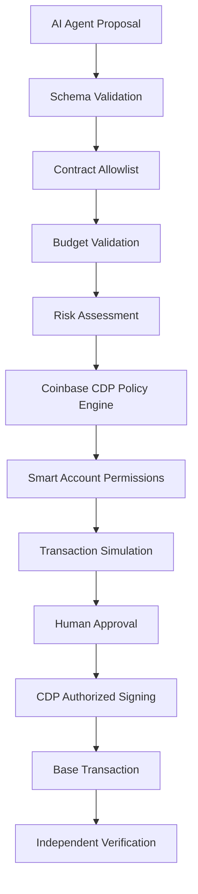

COINBASE INTELLIGENCE
Autonomous Multi-Agent Financial Intelligence & Onchain Agent Economy
<p align="center">
A Coinbase-native multi-agent AI platform combining financial intelligence, programmable wallets, Base smart contracts, decentralized agent identity, cryptographic research verification, and autonomous machine-to-machine commerce.


Coinbase CDP · Coinbase MCP · Advanced Trade · Base · ERC-8004 · x402 · USDC · ERC-4337 · Solidity · LangGraph · MCP · A2A
</p>

TABLE OF CONTENTS
PAGE 01 — Project Overview
PAGE 02 — Core Innovation
PAGE 03 — Coinbase Technology Stack
PAGE 04 — System Architecture
PAGE 05 — Multi-Agent Intelligence Engine
PAGE 06 — Agent Orchestration and Communication
PAGE 07 — Coinbase Portfolio and Market Intelligence
PAGE 08 — Quantitative Research and Strategy Laboratory
PAGE 09 — Risk Intelligence and Transaction Authorization
PAGE 10 — Coinbase CDP Wallet Infrastructure
PAGE 11 — Base Blockchain Architecture
PAGE 12 — Solidity Smart Contracts
PAGE 13 — ERC-8004 Agent Trust Network
PAGE 14 — Cryptographic Research Attestations
PAGE 15 — Merkle Tree Verification
PAGE 16 — Coinbase x402 Agent Economy
PAGE 17 — Onchain Agent Marketplace and USDC Escrow
PAGE 18 — Data Architecture and Backend APIs
PAGE 19 — Security, Testing and Observability
PAGE 20 — Installation, Deployment and Developer Guide
Environment Variables
API Reference
Security Policy
License

PAGE 01 — PROJECT OVERVIEW
1.1 What is Coinbase Intelligence?
COINBASE INTELLIGENCE is an advanced multi-agent AI financial infrastructure platform built around Coinbase's developer ecosystem.
The platform combines specialized AI agents, Coinbase account connectivity, quantitative financial intelligence, programmable wallet infrastructure, Base smart contracts, decentralized agent identity, cryptographic verification, and stablecoin-based agent commerce.
Rather than relying on a single AI assistant to interpret financial information and recommend actions, Coinbase Intelligence deploys a coordinated network of autonomous specialist agents.
Each agent operates within a defined responsibility, accesses authorized tools, produces structured findings, and contributes to an auditable decision-making workflow.
The platform connects financial research with onchain execution infrastructure.
Its central engineering concept is:
AI agents should be able to research, collaborate, discover services, verify each other's work, and participate in controlled economic transactions through Coinbase's blockchain infrastructure.
1.2 The problem
Traditional cryptocurrency applications typically separate financial analysis, trading infrastructure, wallet management, smart contracts, and blockchain analytics.
AI assistants add another layer, but many implementations are still limited to conversational interfaces.
Several problems remain:
Financial research is frequently disconnected from the user's actual account context.
AI recommendations may lack independent numerical verification.
Agents often have insufficiently defined permissions.
Payment systems are not integrated into agent workflows.
External AI services are difficult to evaluate consistently.
Blockchain interactions lack unified application-level audit trails.
Research results are not always independently verifiable.
Multi-agent financial workflows can be difficult to secure.
Coinbase Intelligence addresses these challenges through a unified financial and blockchain infrastructure.
1.3 The solution
The platform integrates Coinbase's developer products with a hierarchical multi-agent architecture.
<escape>
```text
 COINBASE INTELLIGENCE
 |
 +----------------+----------------+
 | | |
 v v v
 FINANCIAL AI AGENT BLOCKCHAIN
 INTELLIGENCE INTELLIGENCE INFRASTRUCTURE
 | | |
 v v v
 Coinbase MCP Multi-Agent Coinbase CDP
 Advanced Trade Orchestrator Smart Accounts
 | | |
 +----------------+----------------+
 |
 v
 BASE NETWORK
 |
 +-----------------+------------------+
 | | |
 v v v
 AGENT IDENTITY RESEARCH AGENT
 ERC-8004 ATTESTATIONS ESCROW
 | | |
 +-----------------+------------------+
 |
 v
 COINBASE x402
 |
 v
 DECENTRALIZED AGENT ECONOMY
```
</escape>
1.4 Core capabilities
Category
Platform capability
Coinbase integration
Coinbase MCP and Advanced Trade
Wallet infrastructure
CDP EOA and Smart Accounts
AI orchestration
Hierarchical multi-agent system
Financial research
Portfolio and market intelligence
Quantitative analysis
Statistical models and backtesting
Risk management
Financial and transaction policy engine
Blockchain
Base EVM infrastructure
Smart contracts
Agent registry, research receipts and escrow
Agent identity
ERC-8004
Agent reputation
Onchain feedback and reputation analysis
Agent validation
Independent onchain verification
Payment infrastructure
Coinbase x402
Settlement
USDC milestone-based escrow
Research verification
Cryptographic hashes and Merkle trees
Observability
Agent traces and blockchain audit history

1.5 Product philosophy
Coinbase Intelligence is designed around five engineering principles:
Coinbase-first infrastructure: Coinbase is central to financial connectivity, wallet management, market access, and payment infrastructure.
Specialized intelligence: Different agents independently investigate financial and blockchain problems.
Verifiable outputs: Important findings can be independently reproduced and cryptographically attested.
Constrained autonomy: Agents operate within explicit authorization and permission boundaries.
Onchain accountability: Important identities, validation records, transactions, and settlements can be inspected through Base.

PAGE 02 — CORE INNOVATION
2.1 From trading assistant to autonomous financial infrastructure
Coinbase Intelligence is not simply a trading bot.
Its core innovation is the combination of financial intelligence and an autonomous agent economy.
The platform allows multiple specialist agents to operate as a coordinated financial research and service organization.
One agent can analyze a Coinbase portfolio.
Another can investigate historical market data.
Another can challenge a strategy.
Another can independently verify the calculations.
A specialized external agent can be hired to provide additional intelligence.
The resulting research can be cryptographically recorded and independently inspected.
2.2 Six engineering layers
The architecture is organized into six development layers.
Layer
Function
L1 — Coinbase Connectivity
Account data, markets and supported financial operations
L2 — AI Intelligence
Research, quantitative analysis and orchestration
L3 — Programmable Wallets
CDP accounts, permissions and transaction controls
L4 — Onchain Verification
Base contracts, identities and attestations
L5 — Agent Economy
Discovery, reputation, x402 and escrow
L6 — Governance and Observability
Risk controls, auditing and operational monitoring

2.3 Autonomous agent workflow
A user can submit an objective:
"Analyze my Coinbase portfolio, evaluate market conditions, and prepare a hypothetical rebalancing strategy."
The platform coordinates the entire workflow.
<escape>
```mermaid
flowchart TD
 A["User Objective"] --> B["Coinbase Intelligence Orchestrator"]
B --> C["Portfolio Analyst"]
B --> D["Market Intelligence"]
B --> E["Quantitative Research"]

C --> F["Shared Research Context"]
D --> F
E --> F

F --> G["Risk Officer"]
G --> H["Independent Verification"]

H --> I{"Research Valid?"}
I -->|No| J["Request More Evidence"]
J --> B

I -->|Yes| K["Generate Final Research Report"]

K --> L["Cryptographic Attestation"]
L --> M["Optional Base Settlement"]

M --> N["Audit Ledger"]

</escape>

## 2.4 Multi-agent collaboration

The system implements independent agent responsibilities rather than treating multiple prompts as independent intelligence.

Agents can:

- Receive separate tasks.
- Access authorized tools.
- Maintain their own execution records.
- Return structured findings.
- Disagree with other agents.
- Request additional evidence.
- Trigger independent verification.
- Generate transaction proposals.

## 2.5 Blockchain-enabled trust

Coinbase Intelligence also integrates decentralized agent trust.

External agents can advertise their:

- Identity.
- Capabilities.
- Wallets.
- MCP endpoints.
- A2A endpoints.
- x402 services.
- Reputation records.
- Validation history.

This allows the application to move beyond a closed set of internal AI agents.

## 2.6 Economic coordination

The platform supports two separate payment models.

**Immediate API payments**

Coinbase x402 enables supported HTTP-based paid service interactions.

**Multi-stage service agreements**

Base escrow contracts support funded jobs, milestones, review periods, disputes, and settlement.

This distinction is fundamental.

A small paid research request does not need an escrow contract, while a multi-stage engagement can benefit from conditional settlement.

---

# PAGE 03 — COINBASE TECHNOLOGY STACK

Coinbase is the primary infrastructure provider for the platform's financial and onchain capabilities.

## 3.1 Coinbase Developer Platform

The Coinbase Developer Platform provides the application with wallet, blockchain, authentication, and related developer infrastructure.

Primary documentation:

https://docs.cdp.coinbase.com/

Core integrations:

- CDP SDK.
- CDP EVM accounts.
- CDP Smart Accounts.
- CDP Policy Engine.
- CDP Onchain Data.
- CDP x402 infrastructure.
- CDP Wallet APIs.

## 3.2 Coinbase for Agents / MCP

Coinbase MCP provides an agent-oriented interface for supported Coinbase functionality.

Official documentation:

https://docs.cdp.coinbase.com/ai-agents/coinbase-for-agents/coinbase-mcp

Coinbase Intelligence uses this integration to connect authorized AI workflows to supported Coinbase account and market operations.

The connector is capability-driven.

The system discovers the tools and permissions available to a connection rather than assuming every account has every capability.

### Connector responsibilities

- Authentication lifecycle.
- Capability discovery.
- Tool schema validation.
- Account information retrieval.
- Portfolio information retrieval.
- Supported market queries.
- Supported order-preview workflows.
- Error handling.
- Session monitoring.
- Source provenance.

MCP access is kept separate from Advanced Trade API credentials.

## 3.3 Coinbase Advanced Trade API

The Advanced Trade API provides the platform with Coinbase market and trading integration capabilities.

Official documentation:

https://docs.cdp.coinbase.com/coinbase-app/advanced-trade-apis/overview

The integration layer supports documented operations for:

| Capability | Purpose |
|---|---|
| Products | Discover supported trading pairs |
| Product candles | Historical OHLCV data |
| Product book | Order-book analysis |
| Ticker | Market-price monitoring |
| WebSocket | Streaming market data |
| Accounts | Authorized account information |
| Orders preview | Estimate supported order parameters |
| Orders | Supported order lifecycle |
| Fills | Execution history |
| Fees | Fee information |

Each operation is represented through typed provider interfaces.

## 3.4 Coinbase CDP Wallets

CDP supports several wallet/account types.

Coinbase Intelligence uses the appropriate account configuration for each use case.

| Account type | Intended role |
|---|---|
| EOA | Owner/signing account |
| Smart Account | Programmable EVM transaction account |
| Solana account | Optional future network extension |

Smart Accounts use ERC-4337 account-abstraction architecture.

Coinbase documentation describes support for batching, gas sponsorship, and spend permissions on supported networks. A Smart Account has an EOA owner. [CDP Wallet documentation](https://docs.cdp.coinbase.com/server-wallets/v2/using-the-wallet-api/managing-accounts).

## 3.5 Coinbase CDP Policy Engine

The Policy Engine applies rules to supported wallet operations.

Coinbase Intelligence uses it as a separate enforcement layer.

Policy examples:

- Allowed destination addresses.
- Approved contract operations.
- Transaction value conditions.
- UserOperation restrictions.
- Signing restrictions.

The policy service does not depend on AI-generated instructions.

[CDP Policy Engine documentation](https://docs.cdp.coinbase.com/api-reference/v2/rest-api/policy-engine).

## 3.6 Coinbase x402

x402 enables HTTP-native payments for protected services.

The platform uses:

- `CdpX402Client`.
- `createX402Server`.
- `createCdpFacilitatorClient`.
- CDP account signer adapters.
- Spend controls.
- Service discovery through CDP Bazaar.

The CDP SDK documents per-payment limits, cumulative limits, network and asset restrictions, and payee allowlists. Importantly, spend controls must be explicitly configured. [CDP SDK x402 documentation](https://github.com/coinbase/cdp-sdk).

## 3.7 Coinbase Payment Acceptance

An optional adapter supports Coinbase Payment Acceptance for eligible business payment workflows.

It is separate from self-custody wallet functionality and x402.

Some Payment Acceptance and custodial API capabilities require verified business onboarding.

[Coinbase Payment Acceptance](https://docs.cdp.coinbase.com/api-reference/payment-acceptance/overview).

## 3.8 Base

Base is the primary EVM network.

| Network | Chain ID | Usage |
|---|---:|---|
| Base Mainnet | 8453 | Production reads and explicitly configured production use |
| Base Sepolia | 84532 | Contract development and testnet transactions |

The application verifies chain identity using the RPC `eth_chainId` method.

[Base chain ID documentation](https://docs.base.org/base-chain/api-reference/ethereum-json-rpc-api/eth_chainId).

---

# PAGE 04 — SYSTEM ARCHITECTURE

## 4.1 High-level architecture

<escape>
```mermaid
flowchart TB
    USER["User / Organization"]

    subgraph FRONTEND["Presentation Layer"]
        WEB["Next.js Application"]
        DASH["Financial Dashboard"]
        AGENTUI["Agent Command Center"]
        CHAINUI["Onchain Control Center"]
        MARKETUI["Agent Marketplace"]
    end

    subgraph BACKEND["Application Backend"]
        API["API Gateway"]
        AUTH["Authentication / Authorization"]
        ORCH["AI Orchestrator"]
        EVENT["Event Manager"]
        POLICY["Policy Engine"]
    end

    subgraph AI["Multi-Agent Intelligence"]
        PA["Portfolio Analyst"]
        MA["Market Analyst"]
        QA["Quant Agent"]
        RA["Risk Agent"]
        VA["Verification Agent"]
        BA["Backtesting Agent"]
        EA["Execution Quality Agent"]
    end

    subgraph COINBASE["Coinbase Infrastructure"]
        MCP["Coinbase MCP"]
        AT["Advanced Trade API"]
        CDP["CDP Wallets"]
        CP["CDP Policy Engine"]
        DATA["CDP Onchain Data"]
        X402["x402 / Bazaar"]
    end

    subgraph BASE["Base Blockchain"]
        ID["ERC-8004 Identity"]
        REP["ERC-8004 Reputation"]
        VAL["ERC-8004 Validation"]
        ATT["Research Attestations"]
        MERKLE["Merkle Batch Anchor"]
        ESCROW["Agent Job Escrow"]
    end

    subgraph DATA_LAYER["Persistence / Observability"]
        PG["PostgreSQL"]
        VEC["pgvector"]
        CACHE["Cache"]
        AUDIT["Audit Ledger"]
        TELEMETRY["Telemetry"]
    end

    USER --> WEB
    WEB --> API
    API --> AUTH
    API --> ORCH
    ORCH --> AI

    AI --> MCP
    AI --> AT
    AI --> DATA

    ORCH --> POLICY
    POLICY --> CP
    CP --> CDP
    CDP --> BASE

    X402 --> AI

    CDP --> ID
    CDP --> ATT
    CDP --> MERKLE
    CDP --> ESCROW

    ID --> REP
    ID --> VAL

    API --> PG
    ORCH --> VEC
    EVENT --> AUDIT
    EVENT --> TELEMETRY
</escape>
4.2 Architectural boundaries
The platform separates five types of systems.
1. Financial data systems
Coinbase account and market data integrations.
2. AI reasoning systems
Agent orchestration, specialist analysis and verification.
3. Authorization systems
Application security policies, CDP Policy Engine, Smart Account permissions, and user approval.
4. Blockchain systems
Base contracts, transaction execution, event indexing, and attestations.
5. Economic systems
x402 service payments and milestone-based escrow.
This separation prevents an AI model from directly controlling a financial account.
4.3 Request lifecycle
Each request begins as an application task.
The orchestrator creates a task ID, establishes the source-data context, and assigns work to specialist agents.
Agent responses are validated before aggregation.
If the workflow requires a financial or blockchain action, a separate authorization path is triggered.
4.4 Design goals
Modularity.
Typed service boundaries.
Independent agent capabilities.
Reproducible financial calculations.
Exact decimal arithmetic.
Idempotent transactions.
Onchain verification.
Persistent audit records.
Resilient integration adapters.
Strict authorization.
4.5 Architecture philosophy
The project uses a modular monolith for the main application, with independently defined agent services and integration boundaries.
It does not require every subsystem to become a separate microservice.
This keeps deployment and operational complexity manageable while preserving opportunities for future service extraction.

PAGE 05 — MULTI-AGENT INTELLIGENCE ENGINE
5.1 Overview
The Multi-Agent Intelligence Engine is the central reasoning system.
Its purpose is to divide complex financial and blockchain tasks into smaller specialist investigations.
Each agent is responsible for a defined domain.
The orchestrator manages task planning, delegation, context, execution and final synthesis.
5.2 Agent workforce
Agent
Main responsibility
Coinbase Portfolio Analyst
Account composition and exposure
Market Intelligence Agent
Coinbase market data
Quantitative Research Agent
Mathematical and statistical modeling
Risk Officer
Financial and transaction risk
Verification Agent
Independent numerical and evidence verification
Execution Quality Analyst
Market microstructure and hypothetical costs
Backtesting Analyst
Historical strategy evaluation
Smart Contract Security Agent
Contract and blockchain-operation analysis
Reputation Analyst
ERC-8004 feedback and trust assessment
Discovery Agent
External agent discovery
Procurement Agent
Paid data and service procurement
Validation Coordinator
Independent validation workflows
Escrow Coordinator
Job and milestone state management
Blockchain Auditor
Onchain event and transaction verification

5.3 Agent isolation
Every agent receives:
Agent ID.
Role.
Task ID.
Authorized capability list.
Read/write permission.
Context references.
Tool list.
Budget reference where applicable.
Execution timeout.
Output schema.
Audit metadata.
No agent inherits unrestricted permissions from the orchestrator.
5.4 Agent output schema
export interface AgentAssessment {
  agentId: string;
  taskId: string;

  status:
    | "pending"
    | "running"
    | "completed"
    | "failed";

  findings: Array<{
    id: string;
    summary: string;
    details: string;
    severity: "info" | "low" | "medium" | "high";
    evidenceRefs: string[];
  }>;

  assumptions: string[];
  limitations: string[];
  confidence: number;

  riskFlags: string[];
  dissentingOpinions: string[];

  sourceMode:
    | "demo"
    | "coinbase"
    | "base"
    | "mixed";

  completedAt?: string;
}
Model outputs are parsed and schema-validated before they enter the shared workflow.
5.5 Independent analysis
For important conclusions, different agents should use separate calculations or data sources where possible.
For example:
The Quant Agent calculates volatility.
The Verification Agent recalculates volatility.
The Risk Officer evaluates interpretation and exposure.
The Market Agent reviews source data quality.
Agreement between agents is not automatically evidence of correctness.
5.6 Agent capability matrix
Capability
Portfolio
Quant
Risk
Security
Auditor
Read portfolio
Yes
Authorized
Authorized
No
Authorized
Read market data
Yes
Yes
Yes
No
Yes
Read Base data
Optional
Optional
Optional
Yes
Yes
Research calculations
Yes
Yes
Yes
No
Yes
Create proposals
No
Yes
No
No
No
Approve transactions
No
No
Veto only
Veto only
No
Sign financial actions
No
No
No
No
No
Verify receipts
No
Yes
Yes
Yes
Yes

Actual tool permissions are enforced outside the LLM.

PAGE 06 — AGENT ORCHESTRATION AND COMMUNICATION
6.1 Hierarchical orchestration
The system uses a supervisor-based architecture.
The Chief Orchestrator:
Receives the user objective.
Classifies the task.
Identifies relevant financial context.
Builds a task graph.
Assigns work to agents.
Executes independent research concurrently.
Collects structured findings.
Triggers risk review.
Triggers verification.
Produces a final output.
6.2 Workflow graph
<escape>
```mermaid
flowchart TD
 START["User Request"]
START --> SUP["Chief Orchestrator"]
SUP --> PLAN["Task Planner"]

PLAN --> P["Portfolio Agent"]
PLAN --> M["Market Agent"]
PLAN --> Q["Quant Agent"]

P --> MERGE["Shared Evidence Context"]
M --> MERGE
Q --> MERGE

MERGE --> R["Risk Review"]
R --> V["Independent Verification"]

V --> G{"Policy / Evidence Check"}

G -->|Insufficient| RESEARCH["Additional Research"]
RESEARCH --> PLAN

G -->|Valid| OUTPUT["Final Report"]

OUTPUT --> ATTEST["Optional Research Attestation"]
ATTEST --> DONE["Audit Event"]

</escape>

## 6.3 Task state management

Every agent task uses a persistent state machine.

```typescript
type TaskStatus =
  | "queued"
  | "planning"
  | "running"
  | "waiting_for_tool"
  | "waiting_for_approval"
  | "verifying"
  | "completed"
  | "failed"
  | "cancelled";
A task is independently traceable.
Timeouts and retries are bounded.
Financial writes are never retried blindly.
6.4 Communication protocol
Use typed task messages.
export interface AgentMessage {
  messageId: string;
  taskId: string;

  senderAgentId: string;
  recipientAgentId: string;

  messageType:
    | "task"
    | "finding"
    | "challenge"
    | "verification"
    | "completion";

  payload: unknown;

  createdAt: string;
}
Validate payload according to its associated task schema.
Do not execute instructions found inside untrusted external research output.
6.5 Memory architecture
Use separate memory scopes.
Working memory: active task context.
Agent memory: specialist history.
Research memory: previous analyses.
Portfolio memory: authorized historical snapshots.
Protocol memory: smart-contract and network information.
Audit memory: prior decisions and execution records.
Sensitive credentials are never stored in agent memory.
6.6 Debate and consensus
The Decision Review Council evaluates:
Independent findings.
Source quality.
Numerical consistency.
Risk flags.
Missing data.
Unresolved disagreements.
A consensus score is informational.
It cannot override a hard security or authorization rejection.

PAGE 07 — COINBASE PORTFOLIO AND MARKET INTELLIGENCE
7.1 Coinbase account connectivity
Coinbase Intelligence supports an account-connected operating model through its Coinbase integration adapters.
The platform distinguishes:
Coinbase MCP authorization.
Advanced Trade API authentication.
CDP wallet authentication.
Base RPC access.
These credentials and capabilities are not interchangeable.
7.2 Portfolio intelligence
The Coinbase Portfolio Analyst retrieves authorized portfolio information and calculates:
Total market value.
Asset allocation.
Concentration.
Cash allocation.
Portfolio drift.
Exposure.
Historical changes.
Performance indicators where supporting data exists.
The application distinguishes market value from cost basis, realized PnL, deposits and withdrawals.
7.3 Multiple portfolio analysis
Coinbase Advanced Trade supports segregated portfolios and portfolio-scoped API keys.
Coinbase Intelligence uses portfolio identifiers to isolate research contexts where supported.
This allows comparative strategy research.
For example:
Alpha: momentum research.
Beta: mean-reversion research.
Gamma: volatility strategy.
Delta: paper trading.
The application does not assume that internal AI agents automatically have independent funded Coinbase portfolios.
Official portfolio documentation.
7.4 Market data
Use the Advanced Trade API for available market information.
Core data:
Product metadata.
Candles.
Ticker updates.
Order-book depth.
Trades.
Market status.
Use the WebSocket feed for streaming information where appropriate.
7.5 Market normalization
interface NormalizedMarketData {
  productId: string;

  price: string;
  bid?: string;
  ask?: string;

  volume?: string;

  source: "coinbase" | "demo";

  timestamp: string;
  receivedAt: string;

  stale: boolean;
}
Use decimal-safe financial arithmetic.
Every market result includes provenance.
7.6 Market microstructure
Calculate:
Bid-ask spread.
Mid-price.
Order-book imbalance.
Bid depth.
Ask depth.
Historical volatility.
Momentum.
Volume changes.
The platform distinguishes observed order-book conditions from predictions.
7.7 Data integrity
Market data is checked for:
Missing intervals.
Duplicate candles.
Invalid prices.
Timestamp inconsistencies.
Stale snapshots.
Unexpected market identifiers.
A market-data failure must not be silently replaced with fabricated live information.

PAGE 08 — QUANTITATIVE RESEARCH AND STRATEGY LABORATORY
8.1 Coinbase Quant Lab
The Quant Lab is a research environment for analyzing Coinbase trading pairs using historical data.
It combines Python analytical services with the TypeScript application.
8.2 Quantitative techniques
Supported calculations include:
Simple moving averages.
Exponential moving averages.
RSI.
ATR.
Historical volatility.
Rolling returns.
Correlation.
Covariance.
Drawdown.
Sharpe ratio.
Value at Risk.
Expected Shortfall where data permits.
Every calculation has a documented input dataset and methodology.
8.3 Strategy modules
Initial strategies include:
Moving Average Crossover
Evaluates short- and long-term moving average signals.
RSI Research
Examines momentum and configured RSI thresholds.
Momentum Strategy
Evaluates historical market direction over selected periods.
Volatility Filter
Examines risk conditions before generating hypothetical exposure.
8.4 Backtesting pipeline
<escape>
```mermaid
flowchart LR
 A["Coinbase Historical Candles"] --> B["Data Validation"]
 B --> C["Indicator Engine"]
 C --> D["Strategy Logic"]
 D --> E["Execution Simulator"]
 E --> F["Fee / Slippage Model"]
 F --> G["Portfolio Accounting"]
 G --> H["Performance Metrics"]
 H --> I["Verification Agent"]
 I --> J["Research Report"]
```
</escape>
8.5 Backtesting standards
The backtester uses chronological data processing.
It prevents look-ahead bias.
It explicitly models:
Initial capital.
Order assumptions.
Transaction fees.
Slippage.
Execution price.
Position sizing.
Exit conditions.
Unfilled orders where modeled.
Every backtest is reproducible using its stored dataset reference and strategy version.
8.6 Results
Generate:
Equity curves.
Drawdown curves.
Benchmark comparisons.
Trade histories.
Monthly returns.
Volatility metrics.
Cost breakdown.
Strategy comparison tables.
Historical simulation results do not imply future returns.
8.7 Research-to-blockchain workflow
A verified research result can be:
Canonicalized.
Hashed.
Associated with the responsible agent.
Included in a Merkle batch.
Anchored on Base.
Independently verified.
This creates verifiable research provenance without publishing private financial data.

PAGE 09 — RISK INTELLIGENCE AND TRANSACTION AUTHORIZATION
9.1 Financial Risk Engine
The Risk Engine evaluates portfolio and strategy-level risks.
Metrics:
Asset concentration.
Historical volatility.
Correlation.
Maximum drawdown.
Historical VaR.
Expected Shortfall.
Liquidity indicators.
Scenario sensitivity.
Portfolio drift.
Risk measurements are accompanied by assumptions and data limitations.
9.2 Portfolio Stress Lab
Scenarios include:
BTC price decline.
ETH price decline.
Multi-asset correction.
Volatility shock.
Spread widening.
Liquidity deterioration.
Asset concentration changes.
These are hypothetical stress tests rather than forecasts.
9.3 Transaction security model
The platform has multiple authorization layers.
<escape>

</escape>
9.4 Coinbase Policy Engine
The Policy Engine protects supported signing and transaction operations.
It is separate from application-level checks.
The policy system is deny-by-default where appropriate.
It supports:
Approved addresses.
Contract restrictions.
Value limits.
Supported operation restrictions.
UserOperation policies.
The exact available rules depend on the configured Coinbase operation and account type.
9.5 Agent permission architecture
Agent
Read
Research
Propose
Sign
Portfolio Analyst
Yes
Yes
No
No
Market Agent
Yes
Yes
No
No
Quant Agent
Yes
Yes
Yes
No
Risk Officer
Yes
Yes
Veto
No
Verification Agent
Yes
Yes
No
No
Security Agent
Blockchain
Yes
Veto
No
Execution Agent
Authorized
Preview
Yes
No direct unrestricted signing

No model can override wallet-level policy restrictions.
9.6 Emergency controls
The blockchain write kill switch:
Stops new write requests.
Prevents new payment authorization.
Blocks new contract submissions.
Preserves read-only operations.
Records the reason for activation.
All controls are server-side.

PAGE 10 — COINBASE CDP WALLET INFRASTRUCTURE
10.1 CDP wallet model
Coinbase Intelligence uses CDP Wallet infrastructure to support programmable wallet interactions.
The wallet layer supports separate account roles.
EOA
Acts as the owner/signing account for applicable Smart Account configurations.
Smart Account
Supports programmable EVM account behavior, including batching and spending permissions on supported networks.
10.2 Smart Account operations
Supported workflows include:
Account management.
Network verification.
Balance retrieval.
Call preparation.
Batched transactions.
UserOperation submission.
UserOperation tracking.
Receipt reconciliation.
10.3 Account abstraction
<escape>
```mermaid
flowchart TB
 OWNER["EOA Owner"] --> SA["ERC-4337 Smart Account"]
SA --> EP["EntryPoint Infrastructure"]
EP --> BUNDLER["Bundler"]
BUNDLER --> BASE["Base Network"]

SA --> P["Programmable Permissions"]
SA --> B["Batched Transactions"]
SA --> G["Optional Gas Sponsorship"]

CDP["Coinbase CDP"] --> OWNER
CDP --> SA

</escape>

## 10.4 Smart Account isolation

Use appropriately separated accounts for:

- Application operations.
- Agent research service payments.
- Testnet contract registration.
- Testnet research attestations.
- Testnet escrow.

Where account separation is used, document the owner and permission relationships.

Do not assume each AI agent automatically controls a separate Smart Account.

## 10.5 Transaction lifecycle

Transactions pass through:

1. Intent creation.
2. Policy validation.
3. Parameter verification.
4. Simulation where supported.
5. Explicit approval.
6. CDP signing.
7. Submission.
8. UserOperation tracking.
9. Transaction receipt.
10. Post-execution verification.

UserOperation hashes and final transaction hashes are stored separately.

## 10.6 Gas sponsorship

Where configured and supported, gas sponsorship reduces friction for permitted onchain operations.

The platform shows:

- Sponsorship availability.
- Gas estimation.
- Sponsorship status.
- Transaction result.

Sponsorship is never assumed merely because the account is a Smart Account.

## 10.7 Wallet security

- Secrets remain server-side.
- CDP manages protected signing infrastructure.
- Agents do not receive private keys.
- Contract calls are restricted.
- Wallet permissions are reviewed.
- Spending controls are explicitly configured.
- Mainnet writes remain disabled by default.

---

# PAGE 11 — BASE BLOCKCHAIN ARCHITECTURE

## 11.1 Why Base?

Base is the primary EVM blockchain for the project's onchain infrastructure.

It provides the execution environment for:

- Agent identity.
- Reputation.
- Validation.
- Research attestation.
- Merkle batching.
- Escrow.
- USDC settlement.
- Blockchain event monitoring.

## 11.2 Network configuration

| Network | Chain ID | Mode |
|---|---:|---|
| Base Mainnet | 8453 | Production read-only by default |
| Base Sepolia | 84532 | Development deployment and writes |

Never select a network solely based on a frontend string.

Retrieve `eth_chainId` from the configured RPC endpoint before submitting a write.

## 11.3 Blockchain integration

The application uses:

- Viem.
- CDP SDK.
- Solidity.
- Foundry.
- Base RPC.
- CDP Onchain Data.

## 11.4 Onchain Data

CDP Onchain Data supports blockchain information retrieval through documented data and RPC interfaces.

Coinbase Intelligence uses it for:

- Wallet balance analysis.
- Transaction history.
- Historical activity.
- Token balance retrieval.
- Smart-contract event verification.
- Blockchain analytics.

## 11.5 Transaction monitor

<escape>
```mermaid
flowchart TD
    TX["Submitted Transaction"] --> P["Pending"]
    P --> I["Included in Block"]
    I --> R["Receipt Retrieved"]
    R --> C["Confirmation Policy"]
    C --> V["Contract State Readback"]
    V --> A["Audit Ledger"]

    R --> F["Failed"]
    I --> RE["Reorganization Check"]
    RE -->|Orphaned| REC["Reconcile / Reprocess"]
    RE -->|Canonical| C
</escape>
11.6 Event indexing
The indexer monitors approved contract addresses.
It processes:
Identity registry events.
Reputation events.
Validation events.
Research attestations.
Merkle batch anchors.
Escrow deposits.
Milestone events.
Payment releases.
Refunds.
The system stores event provenance and block information.
Duplicate events are processed idempotently.
11.7 Explorer integration
The dashboard creates BaseScan links for confirmed transactions.
Mainnet: https://basescan.org
Sepolia: https://sepolia.basescan.org
The links are generated using verified chain IDs and actual transaction hashes.

PAGE 12 — SMART CONTRACT ARCHITECTURE
12.1 Contract inventory
The application uses a modular contract suite.
Contract
Purpose
AgentRegistry.sol
Internal agent identity and capabilities
ResearchAttestationRegistry.sol
Verifiable research commitments
ResearchBatchAnchor.sol
Merkle root anchoring
ERC-8004 Identity Registry
Standardized agent identity
ERC-8004 Reputation Registry
Agent feedback
ERC-8004 Validation Registry
Independent validation
AgentJobEscrow.sol
Conditional milestone settlement

12.2 Contract architecture
<escape>
```mermaid
flowchart TB
 CDP["Coinbase CDP Smart Account"]
subgraph IDENTITY["Identity Layer"]
    AIR["AgentRegistry"]
    EID["ERC-8004 Identity"]
end

subgraph TRUST["Trust Layer"]
    REP["Reputation Registry"]
    VAL["Validation Registry"]
end

subgraph PROVENANCE["Research Layer"]
    ATT["ResearchAttestationRegistry"]
    MRK["ResearchBatchAnchor"]
end

subgraph ECONOMY["Settlement Layer"]
    ESC["AgentJobEscrow"]
    USDC["Approved USDC"]
end

CDP --> AIR
CDP --> EID

EID --> REP
EID --> VAL

CDP --> ATT
ATT --> MRK

CDP --> ESC
USDC --> ESC

</escape>

## 12.3 AgentRegistry

Maintains the application's internal agent identity model.

Responsibilities:

- Agent ID.
- Agent wallet mapping.
- Role metadata.
- Capability hash.
- Registration state.
- Administrative permissions.

## 12.4 ResearchAttestationRegistry

Records cryptographic research commitments.

Stores:

- Task hash.
- Agent ID.
- Output hash.
- Evidence root.
- Dataset reference hash.
- Source mode.
- Attestor.
- Timestamp.

It does not certify the truth of the report.

## 12.5 ResearchBatchAnchor

Anchors multiple research artifact hashes under a Merkle root.

Provides:

- Batch ID.
- Merkle root.
- Leaf count.
- Schema hash.
- Timestamp.
- Submitter.

Supports onchain inclusion verification.

## 12.6 AgentJobEscrow

Manages funded jobs with:

- Buyers.
- Providers.
- ERC-8004 references.
- Approved token.
- Milestones.
- Deadlines.
- Deliverable hashes.
- Disputes.
- Claimable funds.
- Refunds.

## 12.7 Contract development

Use Foundry.

Test:

- Access control.
- Reentrancy protection.
- Arithmetic.
- State transitions.
- Duplicate records.
- Invalid tokens.
- Unauthorized release.
- Refund accounting.
- Merkle proofs.
- ERC-8004 compatibility.

No contract should be described as professionally audited unless that audit has actually been completed.

---

# PAGE 13 — ERC-8004 DECENTRALIZED AGENT TRUST NETWORK

## 13.1 Overview

ERC-8004 is used to provide standardized identity, reputation, and validation functionality for AI agents.

The specification is authored by Marco De Rossi, Davide Crapis, Jordan Ellis, and Erik Reppel of Coinbase.

As of November 5, 2026, the Ethereum proposal page still identifies ERC-8004 as DRAFT. The implementation therefore pins the specification revision and tests its interfaces explicitly. [Official ERC-8004 specification](https://eips.ethereum.org/EIPS/eip-8004). 

## 13.2 Three registries

**Identity Registry**

An ERC-721-compatible registry providing agent IDs and registration URIs.

**Reputation Registry**

Records structured client feedback associated with an agent.

**Validation Registry**

Records independent verification requests and validator responses.

These registries provide distinct capabilities.

## 13.3 Agent identity

A globally qualified agent reference includes:

`namespace:chainId:identityRegistryAddress`

For example, an EVM agent registered on Base Sepolia uses:

`eip155:84532:0x...`

Its `agentId` is the token ID assigned by the registry.

## 13.4 Agent registration file

Example:

```json
{
  "type": "https://eips.ethereum.org/EIPS/eip-8004#registration-v1",
  "name": "Coinbase Quantitative Research Agent",
  "description": "Quantitative analysis and historical Coinbase market research.",
  "image": "https://example.com/agents/quant.png",
  "services": [
    {
      "name": "MCP",
      "endpoint": "https://example.com/mcp",
      "version": "2025-06-18"
    },
    {
      "name": "A2A",
      "endpoint": "https://example.com/.well-known/agent-card.json",
      "version": "0.3.0"
    }
  ],
  "x402Support": true,
  "active": true,
  "registrations": [
    {
      "agentId": 1,
      "agentRegistry": "eip155:84532:0x..."
    }
  ],
  "supportedTrust": [
    "reputation",
    "crypto-economic"
  ]
}
All values are illustrative.
13.5 Verified agent wallets
ERC-8004 reserves the agentWallet metadata key and provides a signature-based wallet verification mechanism.
The implementation supports EOA signatures and ERC-1271-compatible smart-account verification according to the selected specification.
13.6 Agent reputation
Reputation is recorded as structured feedback.
It can include:
Quality.
Reliability.
Availability.
Accuracy.
Response time.
Service completion.
Onchain raw feedback is distinct from offchain aggregate trust scores.
13.7 Agent validation
Validation records identify:
Validator.
Agent ID.
Request hash.
Response.
Evidence reference.
Response hash.
Timestamp.
Responses range from 0 to 100.
A validation response is an encoded result, not automatic proof of objective correctness.
13.8 Agent discovery
The platform resolves registrations and advertises:
MCP.
A2A.
Web endpoints.
OASF metadata when supported.
Wallet references.
x402 service information.
Endpoint safety is evaluated independently.
An onchain registration does not guarantee an endpoint is safe.

PAGE 14 — CRYPTOGRAPHIC RESEARCH ATTESTATIONS
14.1 Research provenance
Coinbase Intelligence can generate a verifiable cryptographic record for completed research workflows.
The objective is to make important research artifacts tamper-evident.
A report can be independently checked against the hash committed on Base.
14.2 Attestation lifecycle
<escape>
```mermaid
flowchart TD
 A["Agent Research Task"] --> B["Collect Evidence"]
 B --> C["Numerical Verification"]
 C --> D["Risk Review"]
 D --> E["Compile Final Artifact"]
 E --> F["Canonical JSON"]
 F --> G["Generate Keccak Hash"]
 G --> H["Prepare Attestation"]
 H --> I["CDP Smart Account"]
 I --> J["User Approval"]
 J --> K["Base Transaction"]
 K --> L["Contract Event"]
 L --> M["Readback Verification"]
 M --> N["Research Receipt"]
```
</escape>
14.3 Canonical hashing
The hashing service uses a deterministic canonicalization process.
It handles:
Field order.
Numeric precision.
Timestamp format.
String encoding.
Schema version.
Evidence references.
Use keccak256 for EVM-oriented commitments.
Never hash sensitive financial account data and publish the resulting hash without considering dictionary or correlation attacks.
Use opaque references or random salts for sensitive artifacts where appropriate.
Hashing is not encryption.
14.4 Research receipt
A receipt includes:
interface ResearchReceipt {
  receiptId: string;

  taskIdHash: string;
  agentId: string;

  outputHash: string;
  evidenceRoot: string;
  datasetSnapshotHash: string;

  sourceMode: string;

  chainId: number;
  contractAddress: string;

  transactionHash: string;
  blockNumber: string;

  verificationStatus:
    | "pending"
    | "verified"
    | "invalid";
}
14.5 Independent verification
The Verification Agent:
Retrieves the artifact.
Reconstructs its canonical representation.
Recalculates the hash.
Reads the onchain record.
Compares the hashes.
Verifies the chain and contract.
Produces a verification report.
The UI must distinguish hash integrity from correctness of the research itself.
14.6 Attestation sources
Reports identify their provenance:
Coinbase market data.
Coinbase account data.
Base blockchain data.
External research.
Synthetic demo datasets.
Mixed sources.
No fabricated source attribution is permitted.

PAGE 15 — MERKLE TREE RESEARCH VERIFICATION
15.1 Purpose
Merkle batching allows many research artifacts to be represented by a single cryptographic root commitment.
This improves the efficiency of anchoring large volumes of agent activity.
15.2 Merkle architecture
<escape>
```mermaid
flowchart TD
 A["Research Report A"] --> HA["Leaf A"]
 B["Research Report B"] --> HB["Leaf B"]
 C["Research Report C"] --> HC["Leaf C"]
 D["Research Report D"] --> HD["Leaf D"]
HA --> P1["Parent 1"]
HB --> P1

HC --> P2["Parent 2"]
HD --> P2

P1 --> ROOT["Merkle Root"]
P2 --> ROOT

ROOT --> BASE["Base ResearchBatchAnchor"]

BASE --> PROOF["Inclusion Proof"]

</escape>

## 15.3 Hash construction

Each leaf contains a domain-separated hash of:

- Application identifier.
- Schema version.
- Chain ID.
- Agent identity reference.
- Task identifier.
- Output hash.
- Evidence root.

Pair hashes follow a deterministic ordering convention.

The same algorithm is used in TypeScript and Solidity.

## 15.4 Merkle services

Modules:

- Canonical leaf builder.
- Merkle tree builder.
- Proof generator.
- Proof verifier.
- Batch manager.
- Batch validation.
- Onchain anchor service.

## 15.5 Batch operations

A batch records:

- Batch ID.
- Root hash.
- Number of leaves.
- Schema hash.
- Submission transaction.
- Submission block.
- Submitter.

A new batch must be uniquely identified.

## 15.6 Research inclusion proof

For each report, the platform stores the sibling hashes necessary to reconstruct the Merkle root.

Verification recalculates the root.

If it matches the anchored root, the application confirms inclusion.

## 15.7 Batch dashboard

Show:

- Total research receipts.
- Anchored batches.
- Pending receipts.
- Verified proofs.
- Invalid proofs.
- Batch transactions.
- Latest block.

Do not claim a report is authentic merely because its hash is present in a valid batch.

---

# PAGE 16 — COINBASE x402 AUTONOMOUS AGENT ECONOMY

## 16.1 Overview

Coinbase Intelligence implements x402 as the machine-to-machine payment layer.

x402 is an HTTP-native payment protocol built around the HTTP 402 Payment Required response.

The CDP SDK provides payment clients, resource servers, facilitator support, and CDP-managed wallet signer adapters.

Official resources:

- https://github.com/coinbase/cdp-sdk
- https://github.com/coinbase/x402
- https://docs.cdp.coinbase.com/api-reference/v2/rest-api/x402-facilitator/bazaar-mcp-server

## 16.2 x402 architecture

<escape>
```mermaid
sequenceDiagram
    participant A as Research Agent
    participant B as CDP Bazaar
    participant P as Paid Service Provider
    participant C as CDP x402 Client
    participant F as CDP Facilitator
    participant N as Base Network

    A->>B: Search resources
    B-->>A: Resource metadata

    A->>P: Request research
    P-->>A: 402 Payment Required

    A->>C: Validate payment requirements
    C->>C: Check spending controls

    C->>F: Submit payment verification
    F->>N: Verify / settle payment
    N-->>F: Settlement status

    F-->>P: Verified payment
    P-->>A: Paid resource response
</escape>
16.3 CDP Bazaar
The Bazaar MCP exposes resource discovery tools:
search_resources
proxy_tool_call
These let agents search for paid resources and invoke supported endpoints.
16.4 Consumer architecture
The consumer side can:
Discover services.
Compare pricing.
Inspect schemas.
Validate networks.
Check budgets.
Request approval.
Invoke the paid resource.
Verify the result.
16.5 Provider architecture
The provider side can expose paid services using supported x402 server infrastructure.
Available research services include:
Coinbase market briefs.
Base wallet activity reports.
Agent reputation reports.
Research attestations.
Merkle proof generation.
Blockchain transaction verification.
16.6 Spend controls
Configure explicit controls.
const spendControls = {
  maxAmountPerPayment: {
    atomic: 10000n,
    asset: "0x...",
  },

  maxCumulativeSpend: {
    atomic: 50000n,
    asset: "0x...",
  },

  maxCumulativeSpendWindow: "24h",

  allowedNetworks: [
    "eip155:8453",
  ],
};
This is an illustrative structure; use the installed SDK's actual configuration types and token contract addresses.
Persist cumulative spending records in a durable store when required.
Do not rely on in-memory spend tracking for production spending controls.
16.7 Payment verification
A payment is complete only after the appropriate facilitator and settlement checks succeed.
The platform records:
Payer.
Payee.
Asset.
Network.
Amount.
Transaction reference.
Service request.
Settlement state.
Payment is not proof of service quality.
16.8 Agent economy analytics
The dashboard tracks:
Incoming revenue.
Outgoing research expenses.
Successful settlements.
Rejected payments.
Spending by agent.
Spending by service.
Provider performance.
Usage.
Simulated payment values are never combined with actual settlement figures.

PAGE 17 — ONCHAIN AGENT MARKETPLACE AND USDC ESCROW
17.1 Decentralized service marketplace
The Agent Marketplace connects ERC-8004 discovery, reputation, validation and x402.
Agents can find and hire external specialist agents.
17.2 Discovery-to-payment workflow
<escape>
```mermaid
flowchart TD
 START["Agent Needs External Service"]
START --> SEARCH["ERC-8004 Agent Search"]
SEARCH --> FILTER["Capability Filtering"]
FILTER --> REP["Reputation Analysis"]
REP --> VAL["Validation History"]

VAL --> PRICE["Service Pricing"]
PRICE --> BUDGET["CDP Spend Controls"]
BUDGET --> APPROVAL["User Approval"]

APPROVAL --> PAYMENT["x402 or Escrow"]
PAYMENT --> SERVICE["Agent Executes Task"]

SERVICE --> EVIDENCE["Deliverable + Evidence"]
EVIDENCE --> VERIFY["Independent Validation"]

VERIFY --> SETTLE["Payment / Escrow Settlement"]
SETTLE --> FEEDBACK["ERC-8004 Reputation Feedback"]

</escape>

## 17.3 Immediate procurement versus escrow

Use x402 for:

- Individual API calls.
- Small research requests.
- Immediate data retrieval.
- Usage-based HTTP services.

Use AgentJobEscrow for:

- Larger engagements.
- Multiple milestones.
- Deliverables.
- Review periods.
- Dispute resolution.
- Conditional payment.

## 17.4 AgentJobEscrow

The escrow contract supports:

- Job creation.
- Funding.
- Acceptance.
- Milestone submission.
- Acceptance.
- Disputes.
- Resolution.
- Provider payout.
- Buyer refunds.

## 17.5 USDC payment accounting

Only approved token contracts can be used.

The contract validates actual token movement.

It maintains:

- Funded amount.
- Remaining liability.
- Claimable provider amount.
- Refundable buyer amount.
- Settled amounts.

Financial quantities use integer token units.

Fee-on-transfer and rebasing tokens are not accepted by the initial implementation.

## 17.6 Milestone lifecycle

<escape>
```mermaid
stateDiagram-v2
    [*] --> Created
    Created --> Funded
    Funded --> Accepted
    Accepted --> InProgress

    InProgress --> Submitted

    Submitted --> AcceptedMilestone
    Submitted --> Disputed

    Disputed --> ResolvedProvider
    Disputed --> ResolvedBuyer
    Disputed --> ResolvedSplit

    AcceptedMilestone --> Released

    Released --> InProgress
    Released --> Completed

    ResolvedProvider --> Released
    ResolvedBuyer --> Refunded
    ResolvedSplit --> Settled

    Completed --> [*]
    Refunded --> [*]
    Settled --> [*]
</escape>
17.7 Dispute process
Disputes may involve:
Buyer evidence.
Provider evidence.
Validator findings.
Research receipts.
Deliverable hashes.
An authorized dispute resolver submits the resolution.
An LLM consensus result cannot directly transfer funds.
17.8 Marketplace profile
Each provider profile displays:
ERC-8004 identity.
Wallet.
Service description.
Reputation.
Independent validation.
Jobs completed.
Settlement history.
Disputed jobs.

PAGE 18 — DATA ARCHITECTURE AND BACKEND APIS
18.1 Application stack
Layer
Technology
Frontend
Next.js
Language
TypeScript
Styling
Tailwind CSS
Components
shadcn/ui
Charts
Recharts
Agent orchestration
LangGraph
AI integration
OpenAI Agents SDK / structured LLM provider
Backend
Next.js API / FastAPI analytical services
Blockchain SDK
Viem
Smart contracts
Solidity
Contract testing
Foundry
Coinbase integration
CDP SDK
Agent connectivity
MCP / A2A
Database
PostgreSQL
Vector retrieval
pgvector
Caching
Redis where configured
Financial calculations
Python / TypeScript
Monitoring
OpenTelemetry

The installed package lockfile is the source of truth for exact versions.
18.2 Repository architecture
coinbase-intelligence/
│
├── apps/
│   └── web/
│       ├── app/
│       ├── components/
│       ├── hooks/
│       └── styles/
│
├── src/
│   ├── agents/
│   │   ├── orchestrator/
│   │   ├── portfolio/
│   │   ├── market/
│   │   ├── quant/
│   │   ├── risk/
│   │   ├── verification/
│   │   ├── backtesting/
│   │   ├── security/
│   │   ├── reputation/
│   │   ├── procurement/
│   │   └── escrow/
│   │
│   ├── integrations/
│   │   ├── coinbase-mcp/
│   │   ├── advanced-trade/
│   │   ├── cdp/
│   │   ├── policy-engine/
│   │   ├── onchain-data/
│   │   ├── x402/
│   │   ├── base/
│   │   └── webhooks/
│   │
│   ├── blockchain/
│   │   ├── identity/
│   │   ├── reputation/
│   │   ├── validation/
│   │   ├── attestations/
│   │   ├── merkle/
│   │   ├── escrow/
│   │   ├── transaction/
│   │   └── indexing/
│   │
│   ├── services/
│   │   ├── portfolio/
│   │   ├── market/
│   │   ├── quant/
│   │   ├── risk/
│   │   ├── discovery/
│   │   ├── reputation/
│   │   ├── procurement/
│   │   └── settlement/
│   │
│   ├── security/
│   │   ├── authorization/
│   │   ├── policy/
│   │   ├── permissions/
│   │   ├── budgets/
│   │   └── approval/
│   │
│   ├── database/
│   ├── schemas/
│   ├── models/
│   ├── fixtures/
│   ├── analytics/
│   └── observability/
│
├── contracts/
│   ├── src/
│   │   ├── AgentRegistry.sol
│   │   ├── ResearchAttestationRegistry.sol
│   │   ├── ResearchBatchAnchor.sol
│   │   └── AgentJobEscrow.sol
│   ├── script/
│   ├── test/
│   └── SECURITY.md
│
├── packages/
│   ├── shared-types/
│   ├── agent-protocols/
│   ├── blockchain-utils/
│   └── financial-math/
│
├── tests/
│   ├── unit/
│   ├── integration/
│   ├── agent-evaluation/
│   ├── contracts/
│   ├── security/
│   └── e2e/
│
├── scripts/
├── docker/
├── docs/
├── .env.example
├── README.md
└── package.json
Adapt this structure to the actual source layout.
18.3 Core data entities
Agent
interface Agent {
  id: string;
  name: string;
  role: string;

  erc8004Registry?: string;
  erc8004AgentId?: string;

  walletAddress?: string;
  capabilities: string[];

  status: string;
}
Agent task
interface AgentTask {
  id: string;
  objective: string;

  assignedAgents: string[];

  sourceMode: string;
  status: string;

  findings: string[];

  createdAt: string;
  completedAt?: string;
}
Blockchain transaction
interface BlockchainTransaction {
  id: string;

  chainId: number;

  transactionHash?: string;
  userOperationHash?: string;

  from: string;
  to: string;

  status: string;

  blockNumber?: string;
  blockHash?: string;

  createdAt: string;
}
Research artifact
interface ResearchArtifact {
  id: string;
  taskId: string;
  agentId: string;

  outputHash: string;
  evidenceRoot: string;

  batchId?: string;
  receiptId?: string;

  sourceMode: string;
  createdAt: string;
}
Escrow job
interface AgentJob {
  id: string;

  buyer: string;
  provider: string;

  erc8004Registry: string;
  erc8004AgentId: string;

  tokenAddress: string;
  totalAmount: string;

  milestoneCount: number;

  status: string;

  contractAddress: string;
  transactionHash?: string;
}
18.4 API architecture
Primary API categories:
Endpoint
Purpose
/api/overview
Dashboard
/api/coinbase/status
Coinbase integration health
/api/coinbase/portfolio
Authorized portfolio data
/api/markets
Market information
/api/agents
Agent registry
/api/agents/investigate
Research orchestration
/api/agents/tasks
Task history
/api/quant/backtests
Strategy research
/api/risk/evaluate
Risk evaluation
/api/cdp/wallets
Wallet metadata
/api/cdp/policies
Policy management
/api/chain/network
Base network status
/api/chain/transactions
Transaction history
/api/erc8004/agents
Agent identity
/api/erc8004/reputation
Feedback
/api/erc8004/validation
Validation requests
/api/attestations
Research receipts
/api/merkle/batches
Batch anchoring
/api/x402/resources
Paid resource discovery
/api/marketplace/agents
Service discovery
/api/escrow/jobs
Agent escrow
/api/escrow/disputes
Dispute management

Every route uses authenticated access and validated request schemas.
Never expose CDP signing or administrative secrets to browser code.

PAGE 19 — SECURITY, TESTING AND OBSERVABILITY
19.1 Security architecture
Coinbase Intelligence separates AI reasoning from financial authorization.
The LLM never directly controls private keys.
Agents submit typed intents.
The policy engine validates them.
The user approves relevant operations.
CDP handles authorized wallet operations.
The blockchain auditor independently verifies transaction outcomes.
19.2 Security layers
Layer
Protection
Application
Authentication and authorization
Agent
Role-based tool access
Data
Provenance and validation
Wallet
CDP protected signing
Policy
Coinbase CDP Policy Engine
Transaction
Contract and parameter allowlists
Blockchain
Contract access control
Payment
Explicit spend controls
Settlement
Reconciliation and accounting
Audit
Append-only event history

19.3 Threat model
Address:
Prompt injection.
Malicious MCP resources.
Malicious A2A endpoints.
Untrusted registration metadata.
Tool poisoning.
Unauthorized transaction requests.
Stale approval replay.
Duplicate payment.
Fake transaction receipts.
Invalid ERC-8004 identities.
Sybil reputation attacks.
Malicious token contracts.
Reentrancy.
Smart Account permission abuse.
Webhook forgery.
Blockchain reorganizations.
Data poisoning.
19.4 Onchain verification
Every important blockchain operation is verified using:
Expected network.
Contract address.
Transaction hash.
Transaction receipt.
Block number.
Event logs.
Contract readback.
A transaction hash existing does not automatically mean the operation succeeded.
19.5 Escrow security
Escrow contracts maintain strict accounting invariants.
Important rules:
Accepted milestone amounts cannot exceed funded liabilities.
A milestone cannot settle twice.
Refunds cannot exceed refundable funds.
Dispute allocations must sum to the milestone amount.
Unknown tokens are rejected.
Arbitrary recipients cannot withdraw funds.
19.6 Agent security
External agent output is untrusted.
Agents cannot alter:
Wallet permissions.
Financial budgets.
Contract allowlists.
Policy Engine configuration.
User approvals.
Signing credentials.
19.7 Testing
Application tests
Navigation.
Authentication.
API validation.
Agent orchestration.
Financial calculations.
Data provenance.
Error handling.
Coinbase integration tests
MCP connectivity.
Capability discovery.
Advanced Trade connectivity.
CDP wallet initialization.
Policy validation.
x402 spend controls.
Smart contract tests
Registry access control.
Agent identity.
Research attestations.
Merkle proof verification.
Escrow funding.
Milestone release.
Dispute settlement.
Refunds.
Adversarial tests
Prompt injection.
Invalid contract calls.
Replay transactions.
Duplicate webhook deliveries.
Unauthorized budget reservations.
Invalid Merkle proofs.
Unauthorized ERC-8004 feedback.
19.8 Observability
Use structured logging and trace identifiers.
Track:
Agent executions.
LLM requests.
Tool calls.
Coinbase API latency.
MCP failures.
CDP wallet operations.
Policy rejections.
Blockchain confirmations.
UserOperations.
x402 settlements.
Escrow events.
Merkle batch verification.
Validation outcomes.
Use OpenTelemetry-compatible instrumentation.
19.9 Audit ledger
Every important action should capture:
Actor.
Agent ID.
User ID where applicable.
Task ID.
Source-data references.
Authorization decision.
Transaction intent.
Final transaction.
Execution outcome.
Timestamp.
Maintain append-only historical records.
Corrections should create new records rather than silently rewrite the past.
19.10 Limitations
Blockchain verification does not establish the factual correctness of AI conclusions.
ERC-8004 reputation is subject to Sybil attacks and feedback manipulation.
Smart-contract security requires independent review.
Backtests cannot guarantee future trading performance.
CDP and Coinbase account functionality is subject to product, account, and regional eligibility.
External endpoint registration does not guarantee a service is trustworthy.
Live financial execution requires properly scoped permissions and user authorization.

PAGE 20 — INSTALLATION, DEPLOYMENT AND DEVELOPER GUIDE
20.1 Prerequisites
Suggested development environment:
Node.js 22 or compatible version required by the installed CDP SDK.
pnpm.
Git.
TypeScript.
PostgreSQL.
Python 3.11+ for analytical services where used.
Foundry.
Coinbase Developer Platform account.
Base Sepolia RPC access.
Authorized testnet wallet configuration.
Use the versions pinned in the project's lockfiles.
20.2 Clone repository
git clone https://github.com/OWNER/coinbase-intelligence.git

cd coinbase-intelligence
Replace OWNER with the actual GitHub organization or username.
20.3 Install dependencies
pnpm install
Compile the application:
pnpm build
Run the development server:
pnpm dev
The frontend uses the configured development port.
20.4 Environment setup
Create a local environment file:
cp .env.example .env.local
Populate only the configuration required by the enabled integrations.
Do not commit .env.local.
20.5 Coinbase Developer Platform setup
Create or access a Coinbase Developer Platform project.
Configure the supported API authentication method.
Create the required wallet configuration.
Configure API credentials.
Restrict secrets to the server.
Configure appropriate network access.
Configure the required Policy Engine.
Configure webhook endpoints if enabled.
Validate the connection.
Official portal:
https://portal.cdp.coinbase.com/
20.6 CDP Wallet setup
Create an appropriate EOA owner and Smart Account using the supported Coinbase SDK.
For testnet development:
Configure Base Sepolia.
Fund the test wallet using the supported faucet.
Verify the account address.
Verify the Smart Account owner.
Verify its supported operations.
Verify network identity.
Never paste wallet secrets into the frontend.
20.7 Base contract development
Move into the contract directory:
cd contracts
Install dependencies using the project's pinned Foundry configuration.
Compile:
forge build
Run tests:
forge test
Run additional invariant tests:
forge test --match-path "test/invariant/*"
The final command applies only if the project contains that test structure.
20.8 Base Sepolia deployment
Configure the deployment wallet and RPC through environment variables.
Validate the chain:
cast chain-id --rpc-url "$BASE_SEPOLIA_RPC_URL"
Expected:
84532
Before broadcasting:
Confirm contract constructor parameters.
Confirm token allowlists.
Confirm owner addresses.
Confirm authorized roles.
Confirm the network.
Confirm the exact deployment bytecode.
Deploy only through the reviewed deployment scripts.
Never automatically deploy to Base Mainnet.
20.9 Application testing
Run:
pnpm typecheck
pnpm lint
pnpm test
pnpm build
Run contract validation:
cd contracts

forge build
forge test
Use only scripts actually defined by the repository.
20.10 Running demo mode
Start the application with:
APP_MODE=demo
BLOCKCHAIN_MODE=demo
ENABLE_LIVE_TRADING=false
ENABLE_MAINNET_WRITES=false
Demo mode includes:
Synthetic Coinbase portfolios.
Sample Coinbase trading pairs.
Historical candle fixtures.
Agent investigations.
Quantitative backtests.
Risk scenarios.
ERC-8004 example identities.
Simulated research attestations.
Demonstration Merkle batches.
Simulated x402 procurement.
Escrow job examples.
Simulated transaction lifecycle.
Every synthetic record must be clearly labeled.
20.11 Deployment modes
Mode
Description
Writes
Demo
Fully populated sample environment
Simulated only
Testnet
Coinbase CDP + Base Sepolia
Authorized testnet
Production read-only
Configured live data integrations
No financial writes by default
Production authorized
Separately reviewed and configured capabilities
Explicitly authorized only

20.12 Deployment verification
After deployment, record:
Chain ID.
Contract addresses.
Deployment transaction hashes.
Block numbers.
Compiler version.
Deployment owner.
ABI references.
Verified source links where applicable.
Do not use sample addresses in production configuration.
20.13 Final developer principles
The core codebase must remain:
Type-safe.
Modular.
Testable.
Coinbase-specific.
Blockchain-aware.
Auditable.
Secure by default.
Explicit about data provenance.

ENVIRONMENT VARIABLES
The following is a configuration template. Only activate integrations that have actually been implemented and configured.
# =====================================
# APPLICATION
# =====================================

APP_MODE=demo
NODE_ENV=development

APP_URL=http://localhost:3000

# =====================================
# AI
# =====================================

AI_PROVIDER=demo
OPENAI_API_KEY=

OPENAI_MODEL=

# =====================================
# DATABASE
# =====================================

DATABASE_URL=
REDIS_URL=

# =====================================
# COINBASE CDP
# =====================================

CDP_API_KEY_ID=
CDP_API_KEY_SECRET=
CDP_WALLET_SECRET=
CDP_PROJECT_ID=

# =====================================
# COINBASE MCP
# =====================================

COINBASE_MCP_ENABLED=false
COINBASE_MCP_ENDPOINT=

# Use official supported authentication.
# Do not invent client credentials.

# =====================================
# ADVANCED TRADE
# =====================================

COINBASE_ADVANCED_API_KEY=
COINBASE_ADVANCED_API_SECRET=

COINBASE_MARKET_DATA_ENABLED=false
COINBASE_LIVE_READ_ONLY=false

# =====================================
# BASE
# =====================================

BLOCKCHAIN_MODE=demo

BASE_SEPOLIA_CHAIN_ID=84532
BASE_MAINNET_CHAIN_ID=8453

BASE_SEPOLIA_RPC_URL=
BASE_MAINNET_RPC_URL=

ENABLE_BASE_SEPOLIA_WRITES=false
ENABLE_BASE_MAINNET_WRITES=false

# =====================================
# SMART ACCOUNTS
# =====================================

CDP_SMART_ACCOUNT_ENABLED=false

CDP_WALLET_ADDRESS=
CDP_SMART_ACCOUNT_ADDRESS=

# =====================================
# POLICY ENGINE
# =====================================

CDP_POLICY_ENGINE_ENABLED=false
CDP_POLICY_ID=

# =====================================
# SMART CONTRACTS
# =====================================

AGENT_REGISTRY_ADDRESS=
RESEARCH_ATTESTATION_REGISTRY_ADDRESS=
RESEARCH_BATCH_ANCHOR_ADDRESS=
AGENT_JOB_ESCROW_ADDRESS=

# ERC-8004 registry addresses

ERC8004_IDENTITY_REGISTRY_ADDRESS=
ERC8004_REPUTATION_REGISTRY_ADDRESS=
ERC8004_VALIDATION_REGISTRY_ADDRESS=

# =====================================
# USDC
# =====================================

BASE_USDC_ADDRESS=
BASE_SEPOLIA_USDC_ADDRESS=

# =====================================
# X402
# =====================================

X402_ENABLED=false
X402_PROVIDER_ENABLED=false
X402_CONSUMER_ENABLED=false

X402_REQUIRE_APPROVAL=true

# Configure SDK spend controls in code.
# Environment variables alone do not enforce spending limits.

# =====================================
# ESCROW
# =====================================

ESCROW_ENABLED=false
ESCROW_MAINNET_ENABLED=false

ESCROW_MAX_JOB_AMOUNT=
ESCROW_MAX_MILESTONES=10

# =====================================
# SECURITY
# =====================================

ENABLE_FINANCIAL_WRITES=false
ENABLE_WITHDRAWALS=false

ENABLE_BLOCKCHAIN_KILL_SWITCH=false

# =====================================
# OBSERVABILITY
# =====================================

OTEL_ENABLED=false
OTEL_EXPORTER_OTLP_ENDPOINT=

API REFERENCE
Coinbase endpoints
Endpoint
Description
/api/coinbase/status
Coinbase connection status
/api/coinbase/capabilities
Discovered integration capabilities
/api/coinbase/portfolio
Authorized portfolio retrieval
/api/coinbase/products
Product discovery
/api/coinbase/markets
Market intelligence
/api/coinbase/orders/preview
Supported order-preview workflow

AI agent endpoints
Endpoint
Description
/api/agents
Internal agent registry
/api/agents/investigate
Create research task
/api/agents/tasks
Agent task history
/api/agents/tasks/:id
Task details
/api/agents/debate/:id
Agent debate results
/api/agents/performance
Agent operational metrics

Quantitative research endpoints
Endpoint
Description
/api/quant/indicators
Technical indicators
/api/quant/backtests
Backtesting
/api/quant/strategies
Strategy configurations
/api/quant/results/:id
Backtest results
/api/risk/stress
Stress testing
/api/risk/portfolio
Portfolio risk

Coinbase CDP endpoints
Endpoint
Description
/api/cdp/wallets
Wallet information
/api/cdp/smart-accounts
Smart Account status
/api/cdp/policies
Policy records
/api/cdp/permissions
Spend permissions
/api/cdp/transactions
Wallet transaction history

Blockchain endpoints
Endpoint
Description
/api/chain/status
Network health
/api/chain/transactions
Transaction records
/api/chain/events
Indexed events
/api/chain/contracts
Contract registry
/api/chain/verify
Onchain verification

ERC-8004 endpoints
Endpoint
Description
/api/erc8004/agents
Identity discovery
/api/erc8004/agents/:id
Agent profile
/api/erc8004/reputation/:id
Reputation
/api/erc8004/validation/:id
Validation history
/api/erc8004/discover
External agent discovery

x402 endpoints
Endpoint
Description
/api/x402/resources
Paid resource discovery
/api/x402/procurement
Agent procurement
/api/x402/payments
Payment records
/api/x402/provider
First-party service status
/api/x402/reconciliation
Settlement verification

Escrow endpoints
Endpoint
Description
/api/escrow/jobs
Agent jobs
/api/escrow/jobs/:id
Job details
/api/escrow/milestones
Milestone status
/api/escrow/disputes
Dispute records
/api/escrow/settlements
Settlements
/api/escrow/reconciliation
Accounting verification

All endpoints require appropriate authentication, authorization, validation, and rate limiting.
Actual endpoint availability is determined by the application implementation.

TECHNICAL DESIGN PRINCIPLES
1. Coinbase-native connectivity
Use official Coinbase APIs and SDKs.
Do not reverse engineer private interfaces.
2. Independent agent execution
Give specialist agents separate tools, responsibilities, and structured outputs.
3. Financial precision
Use decimal-safe arithmetic and integer token units.
Avoid floating-point calculations for monetary settlement.
4. Explicit source provenance
Every important result must identify whether it came from Coinbase, Base, an external provider, or demo fixtures.
5. Restricted autonomy
No AI model can independently grant itself permission to move funds.
6. Cryptographic integrity
Research artifacts can be committed using deterministic hashes and Merkle trees.
7. Onchain trust
ERC-8004 identity, reputation, and validation provide standardized trust records.
8. Economic separation
x402 is used for paid API interactions; escrow is used for multi-stage agreements.
9. Auditable execution
All meaningful financial and blockchain state changes are recorded.
10. Safe operation
Base Sepolia is the development write environment. Production write capabilities require separate configuration, authorization, and security review.

DEVELOPMENT ROADMAP
Phase
Engineering achievement
Status
1
Coinbase AI foundation
Complete
2
Quantitative and financial intelligence
Complete
3
Base blockchain and research attestations
Complete
4
Programmable permissions and agent budgets
Complete
5
ERC-8004 decentralized agent trust
Complete
6
Multi-agent escrow and conditional settlement
Complete

Future research directions
Potential extensions include:
Zero-knowledge research verification.
Trusted execution environments.
Cryptographic agent execution attestations.
Decentralized agent job arbitration.
Advanced cross-agent economic models.
Privacy-preserving financial analytics.
Federated agent learning.
Advanced Base event analytics.
Institutional-grade treasury workflows.
More sophisticated agent reputation systems.
These are research directions, not claims of implemented functionality.

SECURITY POLICY
Security is fundamental to Coinbase Intelligence.
The project does not expose private keys, unrestricted signing access, or financial account credentials to language models.
AI-generated operations must pass application validation and appropriate Coinbase-enforced policy checks.
All payment operations require configured spending controls.
All blockchain writes require network verification and explicit authorization.
Smart contracts use access control and financial accounting invariants.
Sensitive information is not published directly onchain.
No external smart-contract audit is claimed unless a real independent audit has been completed.
Security disclosures: Do not open public issues containing private keys, credentials, wallet secrets, or sensitive transaction information.

DISCLAIMER
COINBASE INTELLIGENCE is an independent software project and is not an official Coinbase product.
Coinbase, Coinbase Developer Platform, CDP, and Base are trademarks of their respective owners.
The application integrates with supported Coinbase developer products and blockchain infrastructure.
Market data, analytics, risk measurements, backtests, and AI-generated research are informational and may contain errors.
Historical performance does not predict future results.
AI outputs are not investment advice.
Blockchain transactions are generally irreversible once finalized.
Smart-account operations, payments, and escrow require careful authorization and security review.
Availability of Coinbase products and account capabilities may vary by country, organization, account, product, and permissions.

CONTRIBUTING
Contributions should follow the existing modular architecture.
Recommended development process:
Create a feature branch.
Define the affected subsystem.
Add or update typed interfaces.
Implement the service layer.
Add unit tests.
Add integration tests where relevant.
Update technical documentation.
Validate security assumptions.
Submit a pull request.
Do not introduce new wallet signing capabilities without an explicit security review.
Do not modify smart-contract financial invariants without corresponding tests.

LICENSE
Add the project's actual license here.
Do not assume the project is MIT-licensed unless the repository contains an MIT license file.

ACKNOWLEDGMENTS AND REFERENCES
Coinbase Developer Platform
Coinbase Developer Platform
Coinbase Developer Documentation
Coinbase CDP SDK
Coinbase Advanced Trade API
Coinbase for Agents MCP
Coinbase Smart Accounts
Coinbase Policy Engine
Coinbase x402
Coinbase Bazaar MCP
Blockchain
Base
Base Developer Documentation
Foundry
Viem
OpenZeppelin
Agent Infrastructure
ERC-8004 Trustless Agents
Model Context Protocol
Agent2Agent Protocol
OpenAI Agents SDK
LangGraph

<p align="center">
COINBASE INTELLIGENCE
Financial Intelligence. Autonomous Agents. Verifiable Blockchain Execution.
Built around Coinbase. Powered by AI agents. Connected through Base.
Coinbase Developer Platform · Base · ERC-8004 · x402
</p>
Important final documentation notes
Before publishing, replace the GitHub owner/repository placeholder and populate the real contract addresses, deployment transactions, environment-specific screenshots, and verified test results.
Two technical distinctions are especially important in this README:
ERC-8004 is still marked Draft in the official EIP specification as of November 5, 2026. Its three registries cover identity, reputation, and validation; payments are explicitly outside the standard.
 Ethereum Improvement Proposals+1
Coinbase's CDP x402 SDK has explicit spend-control features, but its documentation warns that CdpX402Client does not apply default spending caps when spendControls are omitted.
 GitHub+1
This makes the README suitable as a technical repository document while avoiding invented deployment addresses or unsupported claims of security certification.

